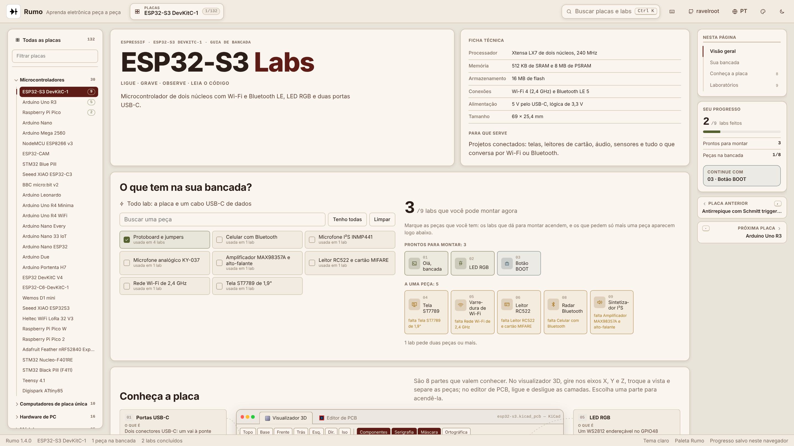
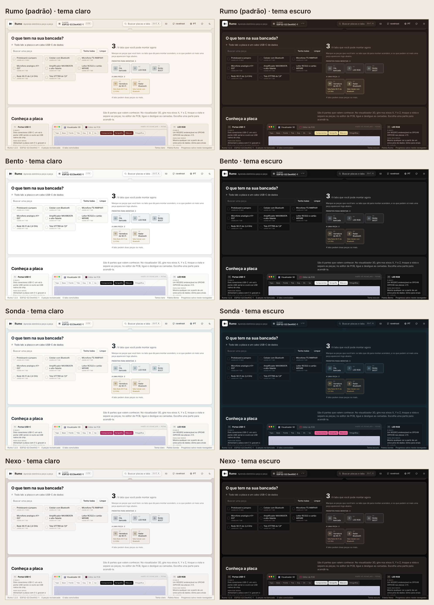
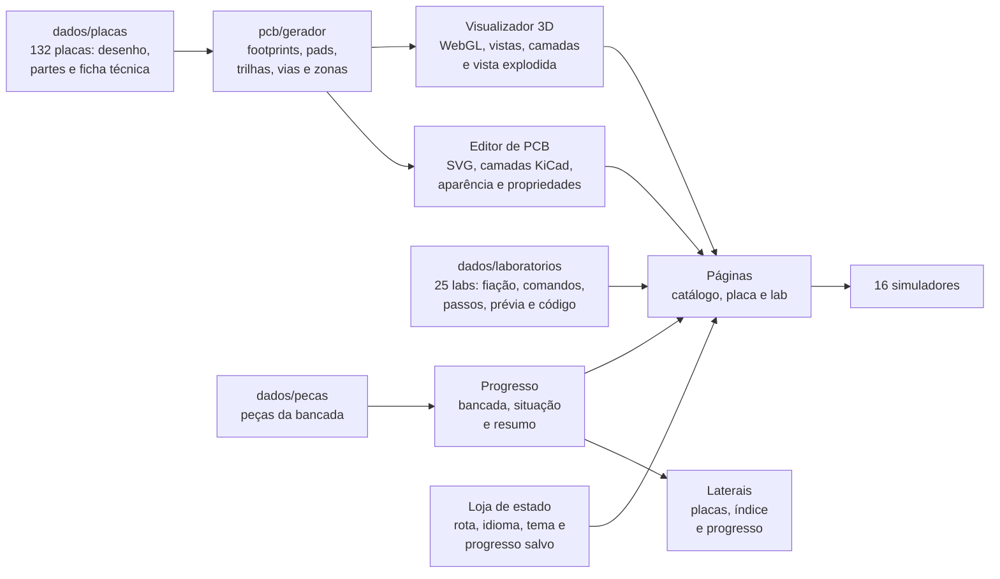

<p align="center">
  
</p>

<h1 align="center">Rumo<br><sub><sup><sup><sub>Copyright (©) 2026 Erik Pimenta</sub></sup></sup></sub></h1>

<p align="center">
  Bancada de eletrônica interativa com 132 placas e circuitos, do ESP32 à placa-mãe, mostrados como no KiCad: um visualizador 3D realista em WebGL, com cobre, máscara de solda, serigrafia, trilhas e componentes modelados, e um editor de PCB técnico em 2D, com as camadas F.Cu, B.Cu, F.Silkscreen, F.Courtyard, F.Fab e Edge.Cuts, painel de aparência e propriedades de cada footprint. Cada placa gira nos três eixos (X, Y e Z), troca de vista, separa as peças numa vista explodida e identifica as 921 partes do catálogo, dizendo o que é cada uma e para que serve. As placas com laboratórios trazem o inventário da bancada, que mostra o que dá para montar com as peças que você tem, e 25 labs com explicação, fiação animada fio a fio, comandos prontos para copiar, passos que ficam salvos, prévia em simulador e código. São 16 simuladores, do monitor serial ao radar Bluetooth, ao sintetizador com som no navegador e aos LEDs de POST de uma placa-mãe. Tudo em português e inglês, com tema claro e escuro, quatro paletas de cores (Rumo, Bento, Sonda e Nexo), busca e atalhos de teclado. Roda inteiro no navegador, sem servidor, com uma única biblioteca em produção (three.js).<br>
  Pronto para usar no navegador.
</p>

<p align="center">
  TypeScript · HTML5 · CSS3 · WebGL (three.js) · SVG · Canvas · Web Audio · Vite · Vitest · Playwright · GitHub Actions · GitHub Pages
</p>

<p align="center">
  <a href="https://ravelroot.github.io/Circuit-Board-Bench-Lab/"><b>Abrir o Rumo no navegador</b></a>
</p>

---

> **Manual completo:** [`Manual-Rumo.pdf`](Manual-Rumo.pdf) explica a instalação, a publicação no GitHub Pages, cada parte da interface (catálogo, ficha técnica, bancada, visualizador 3D e editor de PCB no estilo KiCad, mapa de labs e as seis abas de um lab), os 16 simuladores, a arquitetura do código, o gerador de projetos de PCB, o renderizador 3D em WebGL, o formato de dados de uma placa e de um lab, como adicionar uma placa nova, os testes, a segurança e a solução de problemas, passo a passo (cópia em [`docs/`](docs/Manual-Rumo.pdf)).

> **Banco de dados:** [`Banco-de-Dados-Rumo.pdf`](Banco-de-Dados-Rumo.pdf) traz a sugestão de arquitetura para quando o catálogo sair dos arquivos TypeScript e passar para um banco, com contas e progresso sincronizado: o diagrama de relacionamentos, todas as tabelas com campos, tipos, chaves e restrições (inclusive footprints, pads, trilhas e vias do projeto de PCB), os índices, as decisões (PostgreSQL, textos bilíngues, geometria em JSONB, versões publicadas), os fluxos de dados, a operação e como escalar (cópia em [`docs/`](docs/Banco-de-Dados-Rumo.pdf)).

> **Versão 1.4.0 (Atual):** em telas largas, as **laterais** viram ferramentas. À esquerda, um **navegador de placas** fixo mostra as sete categorias e as 132 placas, com filtro por nome, a placa aberta marcada e o número de labs de cada uma; ele substitui a fileira de chips no alto da página. À direita, o painel **Nesta página** acompanha a rolagem e leva a cada seção, junto com o **seu progresso** (labs feitos, prontos para montar, peças na bancada e o próximo lab sugerido) e a **placa anterior e a próxima**. Num lab, a lateral mostra os passos marcados e todos os labs da placa com a situação de cada um; no catálogo, as categorias, os números do Rumo e o progresso geral. O conteúdo passa a ocupar a largura disponível até 1.680 px, as miniaturas do catálogo começam pelas que estão na tela, os títulos longos dos labs quebram com hífen e a barra de status usa o singular quando é uma peça ou um lab. Em telas menores, tudo continua como antes.

> **Versão 1.3.0:** **100 placas novas**, de 32 para **132**, em **sete categorias**: 20 microcontroladores (Arduino Leonardo, Uno R4 Minima e WiFi, Nano Every, Nano 33 IoT, Nano ESP32, Due e Portenta H7, ESP32 DevKitC, ESP32-C6, D1 mini, XIAO ESP32S3, Heltec LoRa 32, Pico W, Pico 2, Feather nRF52840, Nucleo-F401RE, Black Pill, Teensy 4.1 e Digispark), 8 computadores de placa única (Raspberry Pi 4, 3B+, 3A+, CM4 e Zero W, BeagleBone Black, Jetson Nano e Orange Pi 5), 10 peças de PC, 20 módulos, 22 sensores, 10 módulos de energia e 10 circuitos de bancada. Os sensores e a energia ganharam categorias próprias no catálogo. Cada placa nova tem ficha técnica, partes com "o que é" e "para que serve", modelo 3D e projeto de PCB. Clicar no **logo Rumo** agora volta para a **página inicial** de qualquer lugar (e, se você já estiver nela, sobe ao topo). A troca de placa centraliza a placa atual, o build separa o three.js e o catálogo em arquivos próprios e o gerador de PCB ficou mais preciso nas trilhas a 45°.

> **Versão 1.2.1:** o **menu de paletas** mostra só as amostras de cor de cada paleta, sem o nome. A paleta em uso continua marcada, a tecla `C` continua passando para a próxima e o nome segue no leitor de tela, na dica do botão e na barra de status. As placas, os labs, a bancada e o progresso salvo não mudam.

> **Versão 1.2.0:** nova identidade visual, no mesmo padrão do Grafo, do Crivo e do Pluma: **logo preta em fundo branco**, **fontes do sistema** (texto e monoespaçada) no lugar das fontes baixadas, a **paleta Rumo** (linho, vinho, ardósia e palha) como padrão e um **menu de paletas** com Rumo, Bento, Sonda e Nexo, cada uma com tema claro e escuro. A barra superior, os títulos, os botões, as abas dos labs e a troca de placa seguem a interface dos outros projetos, e uma **barra de status** mostra versão, placa ou lab, peças na bancada, labs concluídos, tema e paleta. A janela no estilo KiCad mantém as cores do Pcbnew e do visualizador 3D. O tema agora começa igual ao do sistema e a aparência é aplicada antes de a tela aparecer, sem piscar. Detalhes em [Paletas de cores](#paletas-de-cores).

> **Versão 1.1.1:** licença que permite só usar e baixar, e topo da página da placa sem a barra de progresso.

<p align="center">
  
</p>

## O que o Rumo faz

- **132 placas e circuitos em sete categorias:** 30 microcontroladores (das famílias Arduino, ESP32, Raspberry Pi Pico, STM32, nRF52, Teensy e outras), 10 computadores de placa única (Raspberry Pi 5, 4, 3B+, 3A+, CM4, Zero W e Zero 2 W, BeagleBone Black, Jetson Nano e Orange Pi 5), 16 peças de hardware de PC (placas-mãe ATX, Micro-ATX e Mini-ITX, placas de vídeo, SSDs, memórias, HD, rede, Wi-Fi, TPM, teclado e fonte), 25 módulos (motores, relés, telas, rádios, rede, cartão SD, relógio e áudio), 25 sensores (ambiente, gás, presença, luz, cor, distância, movimento, força, corrente e som), 12 módulos de energia (reguladores, conversores, carregadores, BMS, fonte da tomada, MOSFET e USB-C PD) e 14 circuitos de bancada (555, 7805, LM386, retificador, astável, 4017, LM358, LM3914, ponte H, fonte simétrica, LDR, termostato, meio somador e Schmitt trigger). A lista completa está em [As 132 placas e circuitos](#as-132-placas-e-circuitos).
- **Visualizador 3D no estilo KiCad:** cada placa é renderizada em WebGL com materiais físicos: FR-4 na borda, máscara de solda com o cobre aparecendo por baixo, pads em ouro (ENIG) ou estanho (HASL), serigrafia com as referências, furos, vias e componentes modelados (QFN, QFP, SOIC, DIP, BGA, blindagens, conectores, barras de pinos, eletrolíticos, cristais, dissipadores, slots, soquete LGA e outros), com luz de estúdio, reflexos e sombras. Há as vistas Topo, Base, Frente, Trás, Esquerda, Direita e Isométrica, camadas de Componentes, Serigrafia e Máscara, projeção ortográfica e o indicador de eixos. Arrastar gira nos eixos X e Z, `Shift` + arrastar gira no Y, e três controles deslizantes ajustam X, Y e Z em graus. Há giro automático, zoom (botões, `Ctrl` + roda ou pinça no celular), botão para centralizar e a vista explodida, que levanta as peças da placa com animação. Passar o mouse mostra a referência, o valor e a biblioteca do footprint.
- **Editor de PCB no estilo KiCad:** a mesma placa em 2D técnico, com as cores do Pcbnew: F.Cu, B.Cu, F.Silkscreen, F.Courtyard, F.Fab e Edge.Cuts, zonas de cobre com isolamento, trilhas a 0°, 45° e 90°, vias, pads SMD e THT, furos de fixação e grade ajustável de 0,635 a 50,8 mm. O painel de aparência liga e desliga camadas e objetos (pads, vias, zonas, referências, valores, números dos pads e grade), o painel de propriedades mostra referência, valor, footprint, camada, posição, corpo, pads e montagem, e a barra de status acompanha o cursor em milímetros. Arrastar move a vista e `Ctrl` + roda ou pinça dá zoom.
- **Peça a peça:** ao lado da placa, um cartão por parte diz **o que é** e **para que serve**, com linhas que ligam o cartão à peça na placa. Escolher um cartão ou clicar na peça, no 3D ou no editor de PCB, acende as duas e apaga o resto. Os cartões mostram também quais labs usam aquela parte.
- **Ficha técnica:** processador, memória, conexões, alimentação, tamanho e usos comuns de cada placa.
- **O que tem na sua bancada?** Marque as peças que você tem e o Rumo mostra quantos labs dá para montar agora, quais estão a uma peça de distância (e qual peça falta) e quantos pedem mais. "Tenho todas" e "Limpar" resolvem com um clique, e a busca filtra as peças.
- **Mapa de laboratórios:** os labs da placa agrupados por tema, com o estado de cada um (feito por você, pronto na bancada, falta uma peça, faltam peças).
- **Lab completo em seis abas:** Como (a teoria em blocos curtos), Fiação (diagrama animado fio a fio com anterior, tocar, próximo e mostrar todos, mais a tabela de pinos), Comandos (prontos para copiar), Passos (checklist salvo no navegador que marca o lab como feito), Prévia (o simulador) e Código (com botão de copiar). A barra de abas acompanha a rolagem e o rodapé leva ao próximo lab ou ao próximo tema.
- **16 simuladores:** monitor serial com comandos e LED (cores, pisca, respiração e SOS), varredura de Wi-Fi com canais e sinal, radar Bluetooth, sintetizador com teclado, formas de onda e som de verdade pelo Web Audio, escopo de dois microfones com bias e comparador, leitor RFID com memória do cartão e créditos, tela ST7789 e LCD 16×2, PWM, servo, ultrassom, mapa dos 40 pinos do Raspberry Pi, slots de memória em dual channel, LEDs de POST com cenários de falha, temporizador 555, regulador 7805 com calor e ponte H.
- **Laterais em telas largas:** a partir de 1.500 px, a lateral esquerda vira um navegador fixo com as sete categorias e as 132 placas, filtro por nome (sem ligar para acentos), a placa aberta marcada e o número de labs de cada uma. A partir de 1.780 px, a lateral direita mostra o índice **Nesta página**, que acompanha a rolagem, o seu progresso na placa, o próximo lab sugerido e as placas vizinhas; num lab, os passos marcados e todos os labs da placa com a situação de cada um; no catálogo, as categorias, os números do Rumo e o progresso geral.
- **Busca e atalhos:** o logo Rumo, no canto superior esquerdo, volta para a página inicial de qualquer lugar. `Ctrl` + `K` ou `/` busca placas, partes e labs nas duas línguas. `,` e `.` trocam de placa, `[` e `]` trocam de lab, `P` abre o catálogo, `C` troca a paleta e `?` mostra todos os atalhos. Com a vista 3D em foco, as setas giram a placa e `E` separa as peças.
- **Idiomas, temas e paletas:** português e inglês em todo o conteúdo, tema claro e escuro (a primeira visita segue o tema do sistema) e quatro paletas de cores: Rumo, Bento, Sonda e Nexo. A escolha, as peças da bancada e os passos marcados ficam salvos no navegador. Detalhes em [Paletas de cores](#paletas-de-cores).
- **Barra de status:** no rodapé, a versão, a placa ou o lab abertos, quantas peças estão na bancada, quantos labs foram concluídos, o tema e a paleta.
- **Projeto de PCB gerado para cada placa:** 1.783 footprints com referências e bibliotecas no padrão do KiCad, mais de 21 mil pads, 4.149 trilhas e 2.642 vias, gerados de forma determinística a partir do desenho de cada placa.
- **Endereço por placa e por lab:** por exemplo, `#/atx` ou `#/esp32-s3/rfid-rc522`, bons para compartilhar ou usar em aula.

<p align="center">
  
</p>

<p align="center">
  
</p>

<p align="center">
  
  
</p>

<p align="center">
  
  
</p>

<p align="center">
  
  
</p>

<p align="center">
  
  
</p>

## Paletas de cores

<p align="center">
  
</p>

O botão com o ícone de paleta, no canto superior direito ao lado do botão de tema, abre a lista das paletas, só com as amostras de cor de cada uma (a tecla `C` passa para a próxima; o nome da paleta em uso aparece na dica do botão e na barra de status). A paleta vale para a interface inteira (barra superior, catálogo, ficha técnica, bancada, cartões das partes, abas dos labs, simuladores e janelas) e funciona junto com o tema claro ou escuro (tecla `T`). A janela no estilo KiCad mantém as cores do Pcbnew e o fundo do visualizador 3D, para continuar igual ao programa.

| Paleta | Origem | Tema claro | Tema escuro |
|---|---|---|---|
| **Rumo** (padrão) | paleta da casa, a mesma do Grafo, do Crivo e do Pluma | linho `#E6DDCE`, vinho `#5D1C16`, ardósia `#A3B4BE`, palha `#F6E4A6` | fundo `#1D1613`, superfície `#30251F`, destaque palha `#F6E4A6` |
| **Bento** | painel administrativo | névoa `#F5F4F4`, cinza `#BAB7B6`, grafite `#4D4B4B`, tinta `#000000` | fundo `#020202`, superfície `#1E1D1D`, destaque branco `#FFFFFF` |
| **Sonda** | motor de busca | areia `#F3F1EC`, azul `#7FA7B8`, noite `#17212B`, magenta `#A8235A` | fundo `#0F161B`, superfície `#151E25`, destaque rosa `#F0679A` |
| **Nexo** | paleta original do Nexo | papel `#E8E8E8`, pó `#D9D1CE`, malva `#AB9D9D`, tinta `#000000` | fundo `#000000`, superfície `#221E1D`, destaque papel `#E8E8E8` |

A escolha fica salva neste navegador e é aplicada antes de a tela aparecer, sem piscar, pelo [`public/aparencia.js`](public/aparencia.js). As paletas são variáveis CSS em `:root[data-paleta]` e `:root[data-tema]` no [`src/css/estilo.css`](src/css/estilo.css), e a lista do menu fica em `PALETAS` no [`src/app/aparencia.ts`](src/app/aparencia.ts). A tipografia usa as fontes do próprio sistema, como no Grafo, no Crivo e no Pluma: `system-ui` para o texto e `ui-monospace` para pinos, comandos e código.

## Arquitetura



| Parte | Responsabilidade |
|---|---|
| `src/dados/tipos.ts` | Contrato de uma placa (desenho, partes, ficha e temas), de um lab e das prévias |
| `src/dados/placas` | As 132 placas, em arquivos por categoria e família, os atalhos de desenho (`formas.ts`) e o catálogo ordenado, com a placa inicial |
| `src/dados/laboratorios` | Os 25 labs e as consultas por placa |
| `src/dados/pecas.ts` | As peças da bancada |
| `src/app` | Estado com leitura validada do navegador, aparência (tema e paleta), rotas, navegador de placas (filtro, vizinhas e seção atual) e cálculo da bancada |
| `src/ui/cabecalho.ts` | Barra superior: logo que leva à página inicial, placa atual, busca, idioma, paleta e tema |
| `src/ui/laterais.ts` | Laterais das telas largas: navegador de placas, índice da página com a seção atual, progresso, labs da placa e placas vizinhas |
| `src/pcb` | O modelo de um projeto de PCB (footprints, pads, trilhas, vias, furos e textos) e o gerador determinístico que classifica cada componente e monta o projeto |
| `src/ui/kicad/janela.ts` | A janela com as abas Visualizador 3D e Editor de PCB |
| `src/ui/kicad/visor3d.ts`, `cena.ts`, `modelos3d.ts`, `texturas.ts` | O visualizador 3D em WebGL: cena, luzes e ambiente, modelos dos componentes, texturas da face (máscara, cobre, serigrafia e acabamento), vistas, explosão, seleção e posição de cada parte na tela |
| `src/ui/kicad/editor2d.ts` | O editor de PCB em SVG: camadas, zonas, grade, cursor, painel de aparência e de propriedades |
| `src/ui/kicad/miniaturas.ts` | As miniaturas 3D do catálogo, renderizadas sob demanda, começando pelas que estão na tela, e guardadas em memória |
| `src/ui/pagina-placa.ts`, `pagina-lab.ts`, `catalogo.ts` | As três páginas |
| `src/ui/fiacao.ts` | Diagrama de fiação animado e tabela de pinos |
| `src/ui/simuladores` | Os 16 simuladores |
| `src/i18n/textos.ts` | Textos da interface em português e inglês |
| `src/css/estilo.css` | Tokens das quatro paletas nos dois temas, layout, janela no estilo KiCad, páginas, simuladores e responsivo |
| `tests/unit` | Catálogo, partes desenhadas, projetos de PCB, labs, bancada, progresso salvo, rotas e navegador de placas |
| `tests/e2e` | Interface de ponta a ponta com Playwright |

### Como uma placa vira um projeto de PCB

Cada componente descreve só a posição, o tamanho em milímetros, a altura e a forma. O gerador classifica cada um num dos 38 modelos de footprint (QFN, QFP, SOIC, SOT, DIP, BGA, blindagem, conector, barra de pinos, slot, eletrolítico, MLCC, cristal, dissipador, soquete LGA e outros), dá a referência no padrão do KiCad (U, J, C, R, D, Y, SW, L, BT, HS), escolhe a biblioteca, gera os pads com o passo e o formato certos (incluindo matrizes BGA e LGA, bordas castelladas e contatos dourados de borda), detecta furos de fixação, liga pads vizinhos com trilhas octilineares em F.Cu e B.Cu com vias, costura as bordas com vias e preenche o plano de terra com isolamento. Tudo é determinístico: a mesma placa gera sempre o mesmo projeto.

O visualizador 3D desenha a face da placa num canvas (máscara, cobre sob a máscara, trilhas, pads com acabamento, vias, furos e serigrafia) e usa outro canvas como mapa de metal e rugosidade, para que só o cobre exposto reflita. Os componentes são modelos em three.js com materiais físicos, iluminados por um ambiente de estúdio, sombras suaves e tone mapping ACES, renderizados só quando algo muda. O editor de PCB desenha o mesmo projeto em SVG, uma camada por grupo, com as cores do Pcbnew.

No build, o three.js, o catálogo de placas e o restante do app saem em três arquivos separados: quando só as placas mudam, o navegador reaproveita o three.js que já estava em cache.

## Como rodar

### No navegador

O Rumo está publicado em **https://ravelroot.github.io/Circuit-Board-Bench-Lab/**. Não precisa instalar nada.

### No seu computador

Você pode baixar o Rumo e rodar no seu computador, exatamente como foi publicado, para uso próprio (veja a [Licença](#licença)). Baixe o `.zip` da última versão em **Releases** ou clone o repositório e rode:

```bash
npm ci
npm run build                     # gera a pasta dist/
npm run preview                   # http://localhost:4173
```

Modificar, vender, redistribuir ou hospedar em outro endereço depende de autorização por escrito do autor.

### Publicando no GitHub Pages

1. No repositório, abra **Settings** → **Pages**.
2. Em **Build and deployment**, escolha **GitHub Actions** como fonte.
3. Envie qualquer commit para a branch `main`. O workflow **GitHub Pages** roda os testes, gera o build e publica.
4. O endereço aparece na própria página de **Pages** e no resumo do workflow.

## Testes e qualidade

```bash
npm run typecheck                 # TypeScript em modo estrito
npm test                          # 1.242 testes unitários com Vitest
npx playwright install chromium
npm run test:e2e                  # interface de ponta a ponta com Playwright
```

Os testes unitários conferem o catálogo (pelo menos 132 placas, ids únicos e seguros para a rota, as sete categorias, cada uma com pelo menos dez placas, e a placa inicial), validam cada placa (textos nas duas línguas, toda parte com "o que é" e "para que serve", toda parte desenhada no 3D e todo componente dentro da placa), cada projeto de PCB (referências únicas no padrão do KiCad, bibliotecas, toda parte com footprint, pads, trilhas, vias e furos dentro da placa e trilhas só a 0°, 45° ou 90°), cada lab (placa, tema, partes e peças existentes, fiação, passos e código sem comentários), a bancada, o progresso salvo, as rotas e o navegador de placas (filtro sem acentos, vizinhas e seção atual). Os testes de interface giram a placa nos três eixos no visualizador 3D, separam as peças, acendem uma parte no 3D e no editor de PCB, ligam e desligam camadas, percorrem o catálogo com as 132 placas, abrem placas novas no 3D, voltam para a página inicial pelo logo, marcam peças e passos, usam o monitor serial, andam pela fiação, testam busca, idioma e tema e usam as laterais numa tela larga (filtro, troca de placa, índice da página e placas vizinhas). O CI roda a auditoria de dependências, o TypeScript, os testes, o build e o Playwright a cada push.

### Segurança

- **Política de segurança de conteúdo** no build: só scripts, estilos e fontes do próprio site, sem `eval`, sem estilos embutidos no HTML, sem objetos e sem formulários.
- **Nada de HTML montado a partir de texto:** a interface cria cada elemento pelo DOM, então nenhum conteúdo vira código.
- **Leitura validada do navegador:** peças, labs e passos salvos são conferidos contra o catálogo, com limite de tamanho, e qualquer valor desconhecido é descartado.
- **Rotas higienizadas:** o endereço só aceita letras, números e hífen e cai no catálogo se a placa não existir.
- **Sem servidor, sem cookies e sem rastreadores.** O áudio do sintetizador é gerado no próprio navegador e só começa com um toque.
- **Dependência única em produção:** só o three.js, com versão fixa. A interface usa as fontes do próprio sistema e nada é baixado de fora. O Dependabot acompanha npm e GitHub Actions toda semana.

## Atalhos de teclado

| Tecla | Ação |
|---|---|
| `Ctrl` + `K` ou `/` | Buscar placas, partes e labs |
| `P` | Catálogo de placas |
| `,` / `.` | Placa anterior / próxima |
| `[` / `]` | Lab anterior / próximo |
| `←` `→` `↑` `↓` | Girar a placa (com a vista 3D em foco) |
| `PgUp` / `PgDn` | Girar no eixo Y (com a vista 3D em foco) |
| `+` / `−` / `0` | Zoom e centralizar (com a vista 3D em foco) |
| `E` | Separar as peças |
| `←` `→` `↑` `↓` / `+` / `−` / `Home` | Mover, aproximar, afastar e ajustar a placa (com o editor de PCB em foco) |
| `G` | Giro automático (com a vista 3D em foco) |
| `T` | Tema claro ou escuro |
| `C` | Próxima paleta de cores |
| `L` | Português ou inglês |
| `Esc` | Fechar a janela aberta |
| `?` | Folha de atalhos |

## As 132 placas e circuitos

| Placa | Resumo | Categoria | Partes | Labs |
|---|---|---|---|---|
| [ESP32-S3 DevKitC-1](https://ravelroot.github.io/Circuit-Board-Bench-Lab/#/esp32-s3) | Microcontrolador de dois núcleos com Wi-Fi e Bluetooth LE, LED RGB e duas portas USB-C. | Microcontrolador | 8 | 9 |
| [Arduino Uno R3](https://ravelroot.github.io/Circuit-Board-Bench-Lab/#/uno-r3) | A placa clássica de 5 V com o ATmega328P em soquete, perfeita para aprender. | Microcontrolador | 11 | 5 |
| [Raspberry Pi Pico](https://ravelroot.github.io/Circuit-Board-Bench-Lab/#/pico) | Placa barata com o RP2040 de dois núcleos, PIO programável e bordas castelladas. | Microcontrolador | 9 | 2 |
| [Arduino Nano](https://ravelroot.github.io/Circuit-Board-Bench-Lab/#/nano) | O Uno em miniatura: mesmo ATmega328P, feito para encaixar na protoboard. | Microcontrolador | 8 | — |
| [Arduino Mega 2560](https://ravelroot.github.io/Circuit-Board-Bench-Lab/#/mega2560) | O Arduino grande: 54 pinos digitais, 16 analógicos e quatro portas seriais. | Microcontrolador | 10 | — |
| [NodeMCU ESP8266 v3](https://ravelroot.github.io/Circuit-Board-Bench-Lab/#/nodemcu) | O avô do ESP32: um módulo ESP-12E com Wi-Fi numa placa de desenvolvimento. | Microcontrolador | 8 | — |
| [ESP32-CAM](https://ravelroot.github.io/Circuit-Board-Bench-Lab/#/esp32-cam) | Um ESP32 com câmera OV2640, slot de microSD e LED de flash num cartão de 40 mm. | Microcontrolador | 8 | — |
| [STM32 Blue Pill](https://ravelroot.github.io/Circuit-Board-Bench-Lab/#/bluepill) | Placa barata com o STM32F103 ARM Cortex-M3 a 72 MHz. | Microcontrolador | 9 | — |
| [Seeed XIAO ESP32-C3](https://ravelroot.github.io/Circuit-Board-Bench-Lab/#/xiao-c3) | Um RISC-V com Wi-Fi e Bluetooth LE do tamanho de um selo, com carregador de bateria. | Microcontrolador | 6 | — |
| [BBC micro:bit v2](https://ravelroot.github.io/Circuit-Board-Bench-Lab/#/microbit) | Placa educativa com matriz de 25 LEDs, dois botões, sensores, microfone e alto-falante. | Microcontrolador | 8 | — |
| [Arduino Leonardo](https://ravelroot.github.io/Circuit-Board-Bench-Lab/#/leonardo) | O formato do Uno com o ATmega32U4, que fala USB direto: vira teclado, mouse ou joystick. | Microcontrolador | 10 | — |
| [Arduino Uno R4 Minima](https://ravelroot.github.io/Circuit-Board-Bench-Lab/#/uno-r4-minima) | O Uno de 32 bits: mesmo formato e 5 V, com processador Arm, USB-C e conversor de 14 bits. | Microcontrolador | 10 | — |
| [Arduino Uno R4 WiFi](https://ravelroot.github.io/Circuit-Board-Bench-Lab/#/uno-r4-wifi) | O Uno R4 com um ESP32-S3 para Wi-Fi e Bluetooth e uma matriz de 96 LEDs na placa. | Microcontrolador | 12 | — |
| [Arduino Nano Every](https://ravelroot.github.io/Circuit-Board-Bench-Lab/#/nano-every) | O Nano atualizado: ATmega4809 com mais memória, mesmo tamanho e 5 V. | Microcontrolador | 7 | — |
| [Arduino Nano 33 IoT](https://ravelroot.github.io/Circuit-Board-Bench-Lab/#/nano-33-iot) | Nano de 32 bits com Wi-Fi, Bluetooth, sensor de movimento e chip de criptografia. | Microcontrolador | 9 | — |
| [Arduino Nano ESP32](https://ravelroot.github.io/Circuit-Board-Bench-Lab/#/nano-esp32) | O ESP32-S3 no formato Nano, com USB-C, LED RGB e suporte a Arduino e MicroPython. | Microcontrolador | 6 | — |
| [Arduino Due](https://ravelroot.github.io/Circuit-Board-Bench-Lab/#/due) | O primeiro Arduino de 32 bits: formato do Mega, Cortex-M3 a 84 MHz e saídas analógicas de verdade. | Microcontrolador | 12 | — |
| [Arduino Portenta H7](https://ravelroot.github.io/Circuit-Board-Bench-Lab/#/portenta-h7) | Arduino profissional com dois núcleos Arm, Wi-Fi, Ethernet e conectores de alta densidade. | Microcontrolador | 10 | — |
| [ESP32 DevKitC V4](https://ravelroot.github.io/Circuit-Board-Bench-Lab/#/esp32-devkitc) | A placa de referência do ESP32 clássico: dois núcleos, Wi-Fi, Bluetooth clássico e BLE. | Microcontrolador | 8 | — |
| [ESP32-C6-DevKitC-1](https://ravelroot.github.io/Circuit-Board-Bench-Lab/#/esp32-c6) | Placa RISC-V com Wi-Fi 6, Bluetooth LE e o rádio 802.15.4 de Thread e Zigbee. | Microcontrolador | 8 | — |
| [Wemos D1 mini](https://ravelroot.github.io/Circuit-Board-Bench-Lab/#/d1-mini) | Um ESP8266 com USB num quadradinho de 34 mm e uma família inteira de shields empilháveis. | Microcontrolador | 8 | — |
| [Seeed XIAO ESP32S3](https://ravelroot.github.io/Circuit-Board-Bench-Lab/#/xiao-s3) | ESP32-S3 com 8 MB de PSRAM do tamanho de um polegar, com antena externa e carregador de bateria. | Microcontrolador | 7 | — |
| [Heltec WiFi LoRa 32 V3](https://ravelroot.github.io/Circuit-Board-Bench-Lab/#/heltec-lora32) | ESP32-S3 com rádio LoRa SX1262, tela OLED e carregador: um nó de longo alcance pronto. | Microcontrolador | 10 | — |
| [Raspberry Pi Pico W](https://ravelroot.github.io/Circuit-Board-Bench-Lab/#/pico-w) | O Pico com Wi-Fi e Bluetooth: mesmo RP2040 e mesmas bordas castelladas. | Microcontrolador | 11 | — |
| [Raspberry Pi Pico 2](https://ravelroot.github.io/Circuit-Board-Bench-Lab/#/pico2) | A segunda geração do Pico: RP2350 com núcleos Arm ou RISC-V, o dobro de memória e mais PIO. | Microcontrolador | 9 | — |
| [Adafruit Feather nRF52840 Express](https://ravelroot.github.io/Circuit-Board-Bench-Lab/#/feather-nrf52840) | Placa Bluetooth LE no formato Feather, com carregador de LiPo e CircuitPython. | Microcontrolador | 10 | — |
| [STM32 Nucleo-F401RE](https://ravelroot.github.io/Circuit-Board-Bench-Lab/#/nucleo-f401re) | Placa de avaliação da ST com depurador embutido, conectores Arduino e todos os pinos do STM32. | Microcontrolador | 7 | — |
| [STM32 Black Pill (F411)](https://ravelroot.github.io/Circuit-Board-Bench-Lab/#/blackpill) | O sucessor da Blue Pill: Cortex-M4F a 100 MHz, USB-C e cristais certos de fábrica. | Microcontrolador | 8 | — |
| [Teensy 4.1](https://ravelroot.github.io/Circuit-Board-Bench-Lab/#/teensy41) | Um Cortex-M7 de 600 MHz programável pela IDE do Arduino, com microSD e Ethernet. | Microcontrolador | 10 | — |
| [Digispark ATtiny85](https://ravelroot.github.io/Circuit-Board-Bench-Lab/#/digispark) | Um microcontrolador que encaixa direto na porta USB, sem cabo, com seis pinos. | Microcontrolador | 6 | — |
| [Raspberry Pi 5](https://ravelroot.github.io/Circuit-Board-Bench-Lab/#/pi5) | Um computador Linux completo do tamanho de um cartão de crédito, com PCIe e dois monitores 4K. | Computador de placa única | 13 | 3 |
| [Raspberry Pi Zero 2 W](https://ravelroot.github.io/Circuit-Board-Bench-Lab/#/pi-zero-2w) | Um Linux de quatro núcleos com Wi-Fi em 65 × 30 mm. | Computador de placa única | 9 | — |
| [Raspberry Pi 4 Model B](https://ravelroot.github.io/Circuit-Board-Bench-Lab/#/pi4) | O Pi que virou desktop: quatro núcleos A72, até 8 GB de RAM, USB 3.0 e dois monitores 4K. | Computador de placa única | 14 | — |
| [Raspberry Pi 3 Model B+](https://ravelroot.github.io/Circuit-Board-Bench-Lab/#/pi3b-plus) | O último Pi no formato clássico com HDMI grande e micro-USB, ainda presente em muitas escolas e projetos. | Computador de placa única | 12 | — |
| [Raspberry Pi 3 Model A+](https://ravelroot.github.io/Circuit-Board-Bench-Lab/#/pi3a-plus) | O Pi 3B+ sem rede cabeada e com uma USB só: mesma potência num quadrado de 65 mm. | Computador de placa única | 10 | — |
| [Raspberry Pi Compute Module 4](https://ravelroot.github.io/Circuit-Board-Bench-Lab/#/cm4) | Um Pi 4 sem conectores, feito para encaixar numa placa base desenhada para cada produto. | Computador de placa única | 7 | — |
| [Raspberry Pi Zero W](https://ravelroot.github.io/Circuit-Board-Bench-Lab/#/pi-zero-w) | O primeiro Zero com Wi-Fi: um núcleo, 512 MB e consumo baixíssimo. | Computador de placa única | 9 | — |
| [BeagleBone Black](https://ravelroot.github.io/Circuit-Board-Bench-Lab/#/beaglebone-black) | Computador Linux com 92 pinos de expansão e dois microcontroladores de tempo real dentro do processador. | Computador de placa única | 13 | — |
| [NVIDIA Jetson Nano Developer Kit](https://ravelroot.github.io/Circuit-Board-Bench-Lab/#/jetson-nano) | Um módulo com GPU de 128 núcleos CUDA sobre uma placa base: inteligência artificial na borda. | Computador de placa única | 11 | — |
| [Orange Pi 5](https://ravelroot.github.io/Circuit-Board-Bench-Lab/#/orange-pi-5) | Computador de placa única com RK3588S de oito núcleos, NPU de 6 TOPS e SSD NVMe por baixo. | Computador de placa única | 13 | — |
| [Placa-mãe ATX](https://ravelroot.github.io/Circuit-Board-Bench-Lab/#/atx) | A placa principal de um PC de mesa: liga processador, memória, vídeo, discos e tudo mais. | Hardware de PC | 16 | 3 |
| [Placa-mãe Mini-ITX](https://ravelroot.github.io/Circuit-Board-Bench-Lab/#/mini-itx) | Uma placa-mãe de 17 × 17 cm com tudo o essencial: um slot PCIe, dois de memória e Wi-Fi. | Hardware de PC | 11 | — |
| [Placa de vídeo (PCB)](https://ravelroot.github.io/Circuit-Board-Bench-Lab/#/gpu) | A placa de circuito de uma placa de vídeo, como fica quando se tira o cooler. | Hardware de PC | 8 | — |
| [SSD M.2 NVMe 2280](https://ravelroot.github.io/Circuit-Board-Bench-Lab/#/ssd-nvme) | Um disco de estado sólido do tamanho de um chiclete, ligado direto à PCIe. | Hardware de PC | 6 | — |
| [Memória DDR5 UDIMM](https://ravelroot.github.io/Circuit-Board-Bench-Lab/#/ddr5) | Um pente de memória de desktop com gerenciamento de energia no próprio módulo. | Hardware de PC | 5 | — |
| [Fonte ATX (vista interna)](https://ravelroot.github.io/Circuit-Board-Bench-Lab/#/fonte-atx) | O interior de uma fonte chaveada de PC, do plugue da tomada aos cabos de 12 V. | Hardware de PC | 10 | — |
| [Placa-mãe Micro-ATX](https://ravelroot.github.io/Circuit-Board-Bench-Lab/#/micro-atx) | A versão quadrada e mais barata da placa-mãe: menos slots, mesmas funções principais. | Hardware de PC | 16 | — |
| [Memória DDR5 SO-DIMM](https://ravelroot.github.io/Circuit-Board-Bench-Lab/#/sodimm-ddr5) | O pente de memória de notebooks e mini PCs, com o próprio regulador de tensão a bordo. | Hardware de PC | 6 | — |
| [Placa lógica de HD 3,5"](https://ravelroot.github.io/Circuit-Board-Bench-Lab/#/hdd-placa) | A placa que fica embaixo do HD: controla o motor, as cabeças e a conversa com o PC. | Hardware de PC | 10 | — |
| [SSD SATA 2,5" (placa interna)](https://ravelroot.github.io/Circuit-Board-Bench-Lab/#/ssd-sata) | Por dentro de um SSD de 2,5": controlador, memória NAND e o mesmo conector de um HD. | Hardware de PC | 6 | — |
| [Placa Wi-Fi M.2 2230 (AX210)](https://ravelroot.github.io/Circuit-Board-Bench-Lab/#/wifi-m2) | Wi-Fi 6E e Bluetooth num cartão de 22 × 30 mm, o mesmo que vai dentro de notebooks. | Hardware de PC | 4 | — |
| [Placa de rede PCIe 2,5 GbE](https://ravelroot.github.io/Circuit-Board-Bench-Lab/#/rede-25g) | Rede cabeada 2,5 vezes mais rápida que gigabit, usando o mesmo cabo Cat5e. | Hardware de PC | 6 | — |
| [Placa de vídeo perfil baixo (GT 1030)](https://ravelroot.github.io/Circuit-Board-Bench-Lab/#/gpu-low-profile) | Placa de vídeo pequena, passiva e sem cabo de energia: tudo vem do slot. | Hardware de PC | 7 | — |
| [Adaptador M.2 NVMe para PCIe](https://ravelroot.github.io/Circuit-Board-Bench-Lab/#/adaptador-nvme) | Placa passiva que encaixa um SSD M.2 NVMe num slot PCIe comum. | Hardware de PC | 5 | — |
| [PCB de teclado mecânico 60 %](https://ravelroot.github.io/Circuit-Board-Bench-Lab/#/teclado-60) | A placa de um teclado mecânico compacto: 61 chaves numa matriz com um diodo em cada tecla. | Hardware de PC | 5 | — |
| [Módulo TPM 2.0](https://ravelroot.github.io/Circuit-Board-Bench-Lab/#/tpm) | Um cofre de chaves criptográficas que encaixa num conector da placa-mãe. | Hardware de PC | 4 | — |
| [Ponte H L298N](https://ravelroot.github.io/Circuit-Board-Bench-Lab/#/l298n) | Módulo com ponte H dupla que controla dois motores DC ou um motor de passo. | Módulo | 8 | 1 |
| [Módulo relé 1 canal 5 V](https://ravelroot.github.io/Circuit-Board-Bench-Lab/#/rele) | Uma chave eletromecânica comandada por um pino de 3,3 ou 5 V. | Módulo | 7 | — |
| [Leitor RFID RC522](https://ravelroot.github.io/Circuit-Board-Bench-Lab/#/rc522) | Leitor e gravador de cartões MIFARE de 13,56 MHz por SPI. | Módulo | 6 | — |
| [Driver de passo A4988](https://ravelroot.github.io/Circuit-Board-Bench-Lab/#/a4988) | Driver de motor de passo bipolar com microstepping até 1/16. | Módulo | 5 | — |
| [Tela OLED 0,96" SSD1306](https://ravelroot.github.io/Circuit-Board-Bench-Lab/#/oled-ssd1306) | Tela OLED de 128 × 64 pixels, sem luz de fundo, por I²C. | Módulo | 5 | — |
| [Driver de passo silencioso TMC2209](https://ravelroot.github.io/Circuit-Board-Bench-Lab/#/tmc2209) | Driver de motor de passo no formato StepStick que deixa o motor quase mudo e detecta travamento. | Módulo | 5 | — |
| [Driver ULN2003 para motor 28BYJ-48](https://ravelroot.github.io/Circuit-Board-Bench-Lab/#/uln2003) | Placa com sete transistores Darlington para girar o pequeno motor de passo 28BYJ-48. | Módulo | 5 | — |
| [Ponte H dupla TB6612FNG](https://ravelroot.github.io/Circuit-Board-Bench-Lab/#/tb6612) | Ponte H de MOSFETs para dois motores DC: menor, mais fria e mais eficiente que o L298N. | Módulo | 4 | — |
| [Controlador de 16 servos PCA9685](https://ravelroot.github.io/Circuit-Board-Bench-Lab/#/pca9685) | Gera 16 sinais PWM independentes por I²C: servos e LEDs sem ocupar os pinos do microcontrolador. | Módulo | 6 | — |
| [Módulo relé 4 canais](https://ravelroot.github.io/Circuit-Board-Bench-Lab/#/rele-4) | Quatro relés com optoacopladores e alimentação da bobina separável do microcontrolador. | Módulo | 8 | — |
| [Display LCD 16×2 com I²C](https://ravelroot.github.io/Circuit-Board-Bench-Lab/#/lcd1602-i2c) | O display de caracteres clássico, com um adaptador que reduz a ligação a quatro fios. | Módulo | 6 | — |
| [Tela TFT 2,8" ILI9341 com toque](https://ravelroot.github.io/Circuit-Board-Bench-Lab/#/ili9341) | Tela colorida de 240 × 320 por SPI, com toque resistivo e leitor de cartão SD atrás. | Módulo | 5 | — |
| [Tela e-paper 2,9"](https://ravelroot.github.io/Circuit-Board-Bench-Lab/#/epaper-29) | Tinta eletrônica de 296 × 128 que mantém a imagem sem gastar energia, como um leitor de livros. | Módulo | 4 | — |
| [Matriz de LED 8×8 MAX7219](https://ravelroot.github.io/Circuit-Board-Bench-Lab/#/max7219) | 64 LEDs vermelhos controlados por um único chip que faz a varredura sozinho. | Módulo | 6 | — |
| [Display de 7 segmentos TM1637](https://ravelroot.github.io/Circuit-Board-Bench-Lab/#/tm1637) | Quatro dígitos com dois-pontos controlados por dois fios. | Módulo | 4 | — |
| [Matriz RGB 8×8 WS2812B](https://ravelroot.github.io/Circuit-Board-Bench-Lab/#/ws2812-matriz) | 64 LEDs RGB endereçáveis: cada um tem seu próprio controlador e todos dividem um fio de dados. | Módulo | 4 | — |
| [Rádio LoRa Ra-02 (SX1278)](https://ravelroot.github.io/Circuit-Board-Bench-Lab/#/lora-ra02) | Rádio de longo alcance e baixo consumo: manda poucos bytes a quilômetros de distância. | Módulo | 4 | — |
| [Rádio 2,4 GHz nRF24L01+](https://ravelroot.github.io/Circuit-Board-Bench-Lab/#/nrf24) | Rádio barato de 2,4 GHz para trocar pacotes curtos entre microcontroladores. | Módulo | 5 | — |
| [Bluetooth serial HC-05](https://ravelroot.github.io/Circuit-Board-Bench-Lab/#/hc05) | Transforma uma porta serial em Bluetooth clássico: o celular vira um terminal sem fio. | Módulo | 6 | — |
| [Ethernet W5500](https://ravelroot.github.io/Circuit-Board-Bench-Lab/#/w5500) | Rede cabeada com a pilha TCP/IP inteira em hardware: o microcontrolador só lê e escreve bytes. | Módulo | 5 | — |
| [Conversor USB-serial FT232RL](https://ravelroot.github.io/Circuit-Board-Bench-Lab/#/ft232rl) | Ponte entre o USB do computador e uma UART de 3,3 ou 5 V. | Módulo | 5 | — |
| [Conversor de nível lógico 4 canais](https://ravelroot.github.io/Circuit-Board-Bench-Lab/#/nivel-logico) | Quatro canais bidirecionais com MOSFET que ligam com segurança 3,3 V a 5 V. | Módulo | 4 | — |
| [Leitor de cartão microSD](https://ravelroot.github.io/Circuit-Board-Bench-Lab/#/microsd) | Slot de microSD com regulador e conversor de nível: gigabytes de armazenamento por SPI. | Módulo | 5 | — |
| [Relógio de tempo real DS3231](https://ravelroot.github.io/Circuit-Board-Bench-Lab/#/ds3231) | Relógio com cristal compensado por temperatura: erra cerca de um minuto por ano e lembra a hora sem energia. | Módulo | 7 | — |
| [Tocador de MP3 DFPlayer Mini](https://ravelroot.github.io/Circuit-Board-Bench-Lab/#/dfplayer) | Toca MP3 de um cartão microSD e já tem amplificador para um alto-falante pequeno. | Módulo | 4 | — |
| [Sensor ultrassônico HC-SR04](https://ravelroot.github.io/Circuit-Board-Bench-Lab/#/hcsr04) | Mede distância pelo eco de um pulso de 40 kHz, de 2 cm a 4 m. | Sensor | 4 | — |
| [Acelerômetro e giroscópio MPU-6050](https://ravelroot.github.io/Circuit-Board-Bench-Lab/#/mpu6050) | Sensor de movimento com acelerômetro e giroscópio de 3 eixos por I²C. | Sensor | 5 | — |
| [GPS u-blox NEO-6M](https://ravelroot.github.io/Circuit-Board-Bench-Lab/#/neo6m) | Receptor GPS que entrega posição, hora e velocidade em frases NMEA pela serial. | Sensor | 7 | — |
| [Sensor de temperatura e umidade DHT22](https://ravelroot.github.io/Circuit-Board-Bench-Lab/#/dht22) | Temperatura e umidade relativa num só fio, com precisão boa para estações caseiras. | Sensor | 4 | — |
| [Sensor ambiental BME280](https://ravelroot.github.io/Circuit-Board-Bench-Lab/#/bme280) | Temperatura, umidade e pressão num chip de 2,5 mm: dá até para estimar a altitude. | Sensor | 4 | — |
| [Termômetro digital DS18B20](https://ravelroot.github.io/Circuit-Board-Bench-Lab/#/ds18b20) | Termômetro digital com número de série próprio: vários dividem um único fio. | Sensor | 4 | — |
| [Sensor de gás e fumaça MQ-2](https://ravelroot.github.io/Circuit-Board-Bench-Lab/#/mq2) | Um elemento aquecido de óxido de estanho que muda de resistência com gás inflamável e fumaça. | Sensor | 6 | — |
| [Sensor de presença PIR HC-SR501](https://ravelroot.github.io/Circuit-Board-Bench-Lab/#/hcsr501) | Percebe o calor de pessoas e animais em movimento atrás de uma lente de Fresnel. | Sensor | 5 | — |
| [Sensor capacitivo de umidade do solo v1.2](https://ravelroot.github.io/Circuit-Board-Bench-Lab/#/umidade-solo) | Mede a umidade da terra pela capacitância, sem cobre exposto que enferruja. | Sensor | 5 | — |
| [Sensor de luz BH1750](https://ravelroot.github.io/Circuit-Board-Bench-Lab/#/bh1750) | Mede a iluminação em lux, com resposta parecida com a do olho humano. | Sensor | 4 | — |
| [Sensor de cor TCS34725](https://ravelroot.github.io/Circuit-Board-Bench-Lab/#/tcs34725) | Lê vermelho, verde, azul e luz total com filtro de infravermelho e um LED branco para iluminar a amostra. | Sensor | 5 | — |
| [Termopar tipo K com MAX6675](https://ravelroot.github.io/Circuit-Board-Bench-Lab/#/max6675) | Lê termopares tipo K até 1024 °C e entrega a temperatura pronta por SPI. | Sensor | 4 | — |
| [Sensor de som KY-037](https://ravelroot.github.io/Circuit-Board-Bench-Lab/#/ky037) | Microfone de eletreto com comparador: avisa quando o som passa de um nível. | Sensor | 6 | — |
| [Microfone digital I²S INMP441](https://ravelroot.github.io/Circuit-Board-Bench-Lab/#/inmp441) | Microfone MEMS que já entrega áudio digital de 24 bits, sem precisar de ADC. | Sensor | 4 | — |
| [Sensor de distância a laser VL53L0X](https://ravelroot.github.io/Circuit-Board-Bench-Lab/#/vl53l0x) | Mede distância pelo tempo de voo de um pulso de laser infravermelho invisível. | Sensor | 4 | — |
| [Acelerômetro ADXL345](https://ravelroot.github.io/Circuit-Board-Bench-Lab/#/adxl345) | Acelerômetro de três eixos que detecta inclinação, toque e queda livre. | Sensor | 4 | — |
| [Sensor seguidor de linha TCRT5000](https://ravelroot.github.io/Circuit-Board-Bench-Lab/#/tcrt5000) | Um LED infravermelho e um fototransistor lado a lado: enxerga se a superfície abaixo é clara ou escura. | Sensor | 6 | — |
| [Encoder rotativo KY-040](https://ravelroot.github.io/Circuit-Board-Bench-Lab/#/ky040) | Um botão giratório sem fim que conta cliques nos dois sentidos e ainda funciona como botão. | Sensor | 4 | — |
| [Joystick analógico KY-023](https://ravelroot.github.io/Circuit-Board-Bench-Lab/#/joystick) | Um manche de videogame: dois potenciômetros nos eixos X e Y e um botão ao apertar. | Sensor | 4 | — |
| [Sensor de efeito Hall A3144](https://ravelroot.github.io/Circuit-Board-Bench-Lab/#/a3144) | Uma chave sem contato: muda de estado quando um ímã se aproxima. | Sensor | 4 | — |
| [Botão de toque capacitivo TTP223](https://ravelroot.github.io/Circuit-Board-Bench-Lab/#/ttp223) | Um botão sem partes móveis: percebe o dedo pela mudança de capacitância, até através de plástico fino. | Sensor | 5 | — |
| [Oxímetro e batimentos MAX30102](https://ravelroot.github.io/Circuit-Board-Bench-Lab/#/max30102) | LEDs vermelho e infravermelho e um fotodetector que leem pulso e oxigenação pela ponta do dedo. | Sensor | 4 | — |
| [Amplificador de célula de carga HX711](https://ravelroot.github.io/Circuit-Board-Bench-Lab/#/hx711) | Conversor de 24 bits feito para pontes de extensômetros: transforma uma célula de carga numa balança. | Sensor | 5 | — |
| [Medidor de corrente INA219](https://ravelroot.github.io/Circuit-Board-Bench-Lab/#/ina219) | Mede corrente, tensão e potência de uma carga DC por I²C, com um resistor shunt de 0,1 Ω. | Sensor | 5 | — |
| [Sensor de corrente ACS712](https://ravelroot.github.io/Circuit-Board-Bench-Lab/#/acs712) | Mede corrente contínua ou alternada pelo campo magnético, com o circuito isolado da carga. | Sensor | 5 | — |
| [Regulador buck LM2596](https://ravelroot.github.io/Circuit-Board-Bench-Lab/#/lm2596) | Conversor DC-DC abaixador ajustável que esquenta muito menos que um regulador linear. | Energia | 7 | — |
| [Carregador de lítio TP4056](https://ravelroot.github.io/Circuit-Board-Bench-Lab/#/tp4056) | Carregador de uma célula de lítio de 1 A com proteção de bateria. | Energia | 7 | — |
| [Elevador de tensão MT3608](https://ravelroot.github.io/Circuit-Board-Bench-Lab/#/mt3608) | Conversor boost minúsculo que transforma 3,7 V de uma bateria em 5, 9 ou 12 V. | Energia | 7 | — |
| [Buck 5 A XL4015 com corrente constante](https://ravelroot.github.io/Circuit-Board-Bench-Lab/#/xl4015) | Abaixador de 5 A com ajuste de tensão e de limite de corrente, bom para carregar baterias e ligar LEDs de potência. | Energia | 9 | — |
| [Regulador AMS1117-3.3](https://ravelroot.github.io/Circuit-Board-Bench-Lab/#/ams1117) | Regulador linear de baixa queda que entrega 3,3 V a partir de 5 V. | Energia | 5 | — |
| [Fonte para protoboard MB102](https://ravelroot.github.io/Circuit-Board-Bench-Lab/#/mb102) | Encaixa na ponta da protoboard e alimenta os trilhos com 3,3 V ou 5 V. | Energia | 8 | — |
| [Regulador ajustável LM317](https://ravelroot.github.io/Circuit-Board-Bench-Lab/#/lm317) | O regulador linear ajustável clássico: dois resistores definem qualquer saída entre 1,25 e 37 V. | Energia | 7 | — |
| [BMS 3S para baterias 18650](https://ravelroot.github.io/Circuit-Board-Bench-Lab/#/bms-3s) | Placa de proteção para três células de lítio em série: corta sobrecarga, descarga profunda e curto. | Energia | 5 | — |
| [Shield de bateria 18650](https://ravelroot.github.io/Circuit-Board-Bench-Lab/#/shield-18650) | Suporte de uma célula 18650 com carregador e saídas de 5 V e 3,3 V: um power bank aberto. | Energia | 8 | — |
| [Fonte AC-DC HLK-PM01](https://ravelroot.github.io/Circuit-Board-Bench-Lab/#/hlk-pm01) | Fonte chaveada encapsulada que tira 5 V isolados direto da tomada. | Energia | 6 | — |
| [Módulo MOSFET IRF520](https://ravelroot.github.io/Circuit-Board-Bench-Lab/#/irf520) | Um MOSFET de potência montado para ligar cargas DC a partir de um pino digital. | Energia | 6 | — |
| [Gatilho USB-C PD CH224K](https://ravelroot.github.io/Circuit-Board-Bench-Lab/#/ch224k) | Negocia com carregadores USB-C Power Delivery e tira 9, 12, 15 ou 20 V da tomada USB. | Energia | 5 | — |
| [Pisca-pisca com NE555](https://ravelroot.github.io/Circuit-Board-Bench-Lab/#/ne555) | O 555 em modo astável: dois resistores e um capacitor definem o ritmo de um LED. | Circuito | 6 | 1 |
| [Fonte regulada com LM7805](https://ravelroot.github.io/Circuit-Board-Bench-Lab/#/lm7805) | Regulador linear clássico: entra de 7 a 20 V, sai 5 V firmes. | Circuito | 6 | 1 |
| [Amplificador de áudio LM386](https://ravelroot.github.io/Circuit-Board-Bench-Lab/#/lm386) | Um amplificador de meio watt que faz um alto-falante tocar a partir de um sinal fraco. | Circuito | 8 | — |
| [Fonte linear com ponte de diodos](https://ravelroot.github.io/Circuit-Board-Bench-Lab/#/retificador) | Transformador, ponte de diodos e filtro: o caminho clássico da tomada até a tensão contínua. | Circuito | 8 | — |
| [Multivibrador astável com transistores](https://ravelroot.github.io/Circuit-Board-Bench-Lab/#/astavel) | Dois transistores que se revezam: um pisca-pisca alternado sem nenhum CI. | Circuito | 5 | — |
| [Sequencial de LEDs com CD4017](https://ravelroot.github.io/Circuit-Board-Bench-Lab/#/sequencial-4017) | Um 555 gera pulsos e o contador 4017 acende dez LEDs em sequência. | Circuito | 6 | — |
| [Pré-amplificador de microfone com LM358](https://ravelroot.github.io/Circuit-Board-Bench-Lab/#/preamp-lm358) | Amplificador operacional em configuração não inversora que aumenta cem vezes o sinal de um microfone. | Circuito | 7 | — |
| [Barra de LEDs com LM3914](https://ravelroot.github.io/Circuit-Board-Bench-Lab/#/vu-lm3914) | Um CI que transforma tensão em uma barra de dez LEDs, sem microcontrolador. | Circuito | 6 | — |
| [Ponte H com transistores](https://ravelroot.github.io/Circuit-Board-Bench-Lab/#/ponte-h-discreta) | Quatro transistores de potência em H: a forma mais visual de inverter o sentido de um motor. | Circuito | 6 | — |
| [Fonte simétrica ±12 V](https://ravelroot.github.io/Circuit-Board-Bench-Lab/#/fonte-simetrica) | Transformador com derivação central, ponte e dois reguladores: +12 V e −12 V para circuitos analógicos. | Circuito | 8 | — |
| [Luz noturna com LDR](https://ravelroot.github.io/Circuit-Board-Bench-Lab/#/luz-noturna) | Um LDR e um transistor acendem um LED sozinhos quando escurece. | Circuito | 6 | — |
| [Termostato com LM393](https://ravelroot.github.io/Circuit-Board-Bench-Lab/#/termostato-lm393) | Um termistor e um comparador ligam uma saída quando a temperatura passa do ponto escolhido. | Circuito | 7 | — |
| [Meio somador com portas lógicas](https://ravelroot.github.io/Circuit-Board-Bench-Lab/#/meio-somador) | Uma porta XOR e uma AND somam dois bits: o primeiro passo de toda calculadora. | Circuito | 7 | — |
| [Antirrepique com Schmitt trigger 74HC14](https://ravelroot.github.io/Circuit-Board-Bench-Lab/#/schmitt-74hc14) | Um filtro RC e um inversor com histerese limpam o repique de um botão mecânico. | Circuito | 6 | — |

## Os 25 laboratórios

| Lab | Placa | Tema | Fiação | Prévia | Código |
|---|---|---|---|---|---|
| [Olá, bancada](https://ravelroot.github.io/Circuit-Board-Bench-Lab/#/esp32-s3/ola) | ESP32-S3 DevKitC-1 | Início | — | Monitor serial | sim |
| [LED RGB](https://ravelroot.github.io/Circuit-Board-Bench-Lab/#/esp32-s3/led-rgb) | ESP32-S3 DevKitC-1 | Início | — | Monitor serial | sim |
| [Botão BOOT](https://ravelroot.github.io/Circuit-Board-Bench-Lab/#/esp32-s3/botao-boot) | ESP32-S3 DevKitC-1 | Início | — | Monitor serial | sim |
| [Tela ST7789](https://ravelroot.github.io/Circuit-Board-Bench-Lab/#/esp32-s3/tela-st7789) | ESP32-S3 DevKitC-1 | Tela e entrada | sim | Tela | sim |
| [Varredura de Wi-Fi](https://ravelroot.github.io/Circuit-Board-Bench-Lab/#/esp32-s3/wifi-scan) | ESP32-S3 DevKitC-1 | Wi-Fi | — | Varredura de Wi-Fi | sim |
| [Leitor RC522](https://ravelroot.github.io/Circuit-Board-Bench-Lab/#/esp32-s3/rfid-rc522) | ESP32-S3 DevKitC-1 | RFID e NFC | sim | Leitor RFID | sim |
| [Dois microfones](https://ravelroot.github.io/Circuit-Board-Bench-Lab/#/esp32-s3/microfones) | ESP32-S3 DevKitC-1 | Sensores | sim | Escopo de microfones | sim |
| [Radar Bluetooth](https://ravelroot.github.io/Circuit-Board-Bench-Lab/#/esp32-s3/radar-ble) | ESP32-S3 DevKitC-1 | Bluetooth LE | — | Radar BLE | sim |
| [Sintetizador I²S](https://ravelroot.github.io/Circuit-Board-Bench-Lab/#/esp32-s3/sintetizador) | ESP32-S3 DevKitC-1 | Som | sim | Sintetizador | sim |
| [Pisca o L](https://ravelroot.github.io/Circuit-Board-Bench-Lab/#/uno-r3/uno-blink) | Arduino Uno R3 | Início | — | Monitor serial | sim |
| [Brilho com PWM](https://ravelroot.github.io/Circuit-Board-Bench-Lab/#/uno-r3/uno-fade) | Arduino Uno R3 | PWM e movimento | sim | PWM | sim |
| [Servo com potenciômetro](https://ravelroot.github.io/Circuit-Board-Bench-Lab/#/uno-r3/uno-servo) | Arduino Uno R3 | PWM e movimento | sim | Servo | sim |
| [LCD 16×2 por I²C](https://ravelroot.github.io/Circuit-Board-Bench-Lab/#/uno-r3/uno-lcd) | Arduino Uno R3 | Tela | sim | Tela | sim |
| [Distância por ultrassom](https://ravelroot.github.io/Circuit-Board-Bench-Lab/#/uno-r3/uno-ultrassom) | Arduino Uno R3 | Sensores | sim | Ultrassom | sim |
| [MicroPython e LED](https://ravelroot.github.io/Circuit-Board-Bench-Lab/#/pico/pico-blink) | Raspberry Pi Pico | Início | — | Monitor serial | sim |
| [Termômetro interno](https://ravelroot.github.io/Circuit-Board-Bench-Lab/#/pico/pico-temperatura) | Raspberry Pi Pico | Sensores | — | Monitor serial | sim |
| [Gravar o sistema](https://ravelroot.github.io/Circuit-Board-Bench-Lab/#/pi5/pi-sistema) | Raspberry Pi 5 | Sistema | — | Monitor serial | — |
| [LED e botão com gpiozero](https://ravelroot.github.io/Circuit-Board-Bench-Lab/#/pi5/pi-gpio) | Raspberry Pi 5 | GPIO | sim | Monitor serial | sim |
| [Mapa dos 40 pinos](https://ravelroot.github.io/Circuit-Board-Bench-Lab/#/pi5/pi-pinagem) | Raspberry Pi 5 | GPIO | — | Mapa de pinos | — |
| [Processador e cooler](https://ravelroot.github.io/Circuit-Board-Bench-Lab/#/atx/atx-cpu) | Placa-mãe ATX | Montagem | — | LEDs de POST | — |
| [Memória em dual channel](https://ravelroot.github.io/Circuit-Board-Bench-Lab/#/atx/atx-memoria) | Placa-mãe ATX | Montagem | — | Slots de memória | — |
| [Primeira partida na bancada](https://ravelroot.github.io/Circuit-Board-Bench-Lab/#/atx/atx-bancada) | Placa-mãe ATX | Primeira partida | — | LEDs de POST | — |
| [Ajustar o pisca](https://ravelroot.github.io/Circuit-Board-Bench-Lab/#/ne555/ne555-pisca) | Pisca-pisca com NE555 | Circuito | — | Temporizador 555 | — |
| [Quanto esquenta o 7805](https://ravelroot.github.io/Circuit-Board-Bench-Lab/#/lm7805/lm7805-fonte) | Fonte regulada com LM7805 | Circuito | — | Regulador linear | — |
| [Sentido e velocidade](https://ravelroot.github.io/Circuit-Board-Bench-Lab/#/l298n/l298n-motor) | Ponte H L298N | Circuito | sim | Ponte H | sim |

## Estrutura de pastas

```
src/
  app/                      estado, aparência, rotas, navegador de placas e cálculo da bancada
  css/                      estilo.css com tokens, janela KiCad, páginas, simuladores e responsivo
  dados/
    placas/                 as 132 placas por categoria e família, formas.ts e o catálogo
    laboratorios/           os 25 labs
    pecas.ts                peças da bancada
    tipos.ts                contrato de dados
  i18n/                     textos da interface em português e inglês
  pcb/                      modelo e gerador dos projetos de PCB
  ui/
    kicad/                  visualizador 3D, editor de PCB, janela e miniaturas
    simuladores/            os 16 simuladores
  main.ts                   ponto de entrada, rotas e atalhos de teclado
public/                     ícone e aparencia.js (tema e paleta antes da primeira pintura)
tests/
  unit/                     Vitest
  e2e/                      Playwright
docs/                       manuais em PDF e imagens do README
.github/                    CI, GitHub Pages e Dependabot
VERSION                     versão do projeto
```

### Componentes de terceiros

O Rumo depende de componentes com licenças próprias, que continuam valendo para cada um deles:

| Componente | Uso no projeto | Licença |
|---|---|---|
| [three.js](https://threejs.org/) | Renderização 3D em WebGL | MIT |
| [Vite](https://vite.dev/) | Servidor de desenvolvimento e build | MIT |
| [TypeScript](https://www.typescriptlang.org/) | Linguagem e verificação de tipos | Apache-2.0 |
| [Vitest](https://vitest.dev/) | Testes unitários | MIT |
| [Playwright](https://playwright.dev/) | Testes de ponta a ponta | Apache-2.0 |

Os desenhos das placas e os projetos de PCB gerados são representações didáticas, com posições e medidas aproximadas, e não substituem o esquema ou a folha de dados do fabricante. Os nomes de produtos e marcas citados pertencem aos seus donos.

## Licença

Copyright (©) 2026 Erik Pimenta. Todos os direitos reservados.

O Rumo é distribuído sob uma [licença de uso](LICENSE) que permite apenas **usar** e **baixar**:

| Permitido | Não permitido sem autorização por escrito |
|---|---|
| Usar a versão publicada, de graça, para estudo, aula ou trabalho | Modificar, adaptar, traduzir ou criar obras derivadas |
| Baixar o repositório ou uma versão de Releases e rodar no próprio computador, sem alterações | Vender, alugar, sublicenciar, cobrar pelo acesso ou incluir em produto ou serviço pago |
| | Redistribuir, publicar, espelhar ou hospedar em outro endereço, mesmo sem alterações |
| | Reutilizar o código, os textos, os dados das placas, os desenhos, os modelos 3D, o nome ou a logo |

Cada cópia baixada é só para quem baixou e deve manter o arquivo [LICENSE](LICENSE). Os componentes de terceiros listados acima continuam sob as próprias licenças. Pedidos de autorização: pelo perfil [ravelroot](https://github.com/ravelroot) no GitHub.
