<p align="center">
  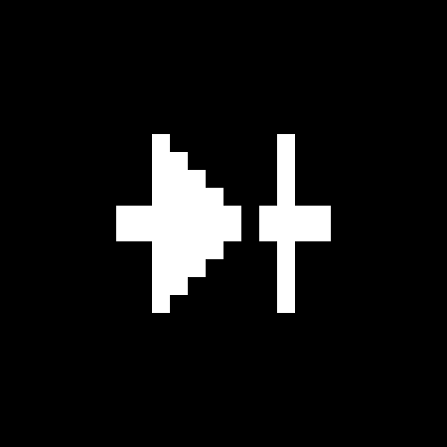
</p>

<h1 align="center">Rumo<br><sub><sup><sup><sub>Copyright (©) 2026 Erik Pimenta</sub></sup></sup></sub></h1>

<p align="center">
  Bancada de eletrônica interativa com 32 placas e circuitos, do ESP32 à placa-mãe, mostrados como no KiCad: um visualizador 3D realista em WebGL, com cobre, máscara de solda, serigrafia, trilhas e componentes modelados, e um editor de PCB técnico em 2D, com as camadas F.Cu, B.Cu, F.Silkscreen, F.Courtyard, F.Fab e Edge.Cuts, painel de aparência e propriedades de cada footprint. Cada placa gira nos três eixos (X, Y e Z), troca de vista, separa as peças numa vista explodida e identifica as 252 partes do catálogo, dizendo o que é cada uma e para que serve. As placas com laboratórios trazem o inventário da bancada, que mostra o que dá para montar com as peças que você tem, e 25 labs com explicação, fiação animada fio a fio, comandos prontos para copiar, passos que ficam salvos, prévia em simulador e código. São 16 simuladores, do monitor serial ao radar Bluetooth, ao sintetizador com som no navegador e aos LEDs de POST de uma placa-mãe. Tudo em português e inglês, com tema claro e escuro na paleta do Bento, busca e atalhos de teclado. Roda inteiro no navegador, sem servidor, com uma única biblioteca em produção (three.js).<br>
  Pronto para usar no navegador.
</p>

<p align="center">
  TypeScript · HTML5 · CSS3 · WebGL (three.js) · SVG · Canvas · Web Audio · Vite · Vitest · Playwright · GitHub Actions · GitHub Pages
</p>

<p align="center">
  <a href="https://ravelroot.github.io/Circuit-Board-Bench-Lab/"><b>Abrir o Rumo no navegador</b></a>
</p>

---

> **Manual completo:** [`Manual-Rumo.pdf`](Manual-Rumo.pdf) explica a instalação, a publicação no GitHub Pages, cada parte da interface (catálogo, ficha técnica, bancada, visualizador 3D e editor de PCB no estilo KiCad, mapa de labs e as seis abas de um lab), os 16 simuladores, a arquitetura do código, o gerador de projetos de PCB, o renderizador 3D em WebGL, o formato de dados de uma placa e de um lab, como adicionar uma placa nova, os testes, a segurança e a solução de problemas, passo a passo (cópia em [`docs/`](docs/Manual-Rumo.pdf)).

> **Banco de dados:** [`Banco-de-Dados-Rumo.pdf`](Banco-de-Dados-Rumo.pdf) traz a sugestão de arquitetura para quando o catálogo sair dos arquivos TypeScript e passar para um banco, com contas e progresso sincronizado: o diagrama de relacionamentos, todas as tabelas com campos, tipos, chaves e restrições (inclusive footprints, pads, trilhas e vias do projeto de PCB), os índices, as decisões (PostgreSQL, textos bilíngues, geometria em JSONB, versões publicadas), os fluxos de dados, a operação e como escalar (cópia em [`docs/`](docs/Banco-de-Dados-Rumo.pdf)).

<p align="center">
  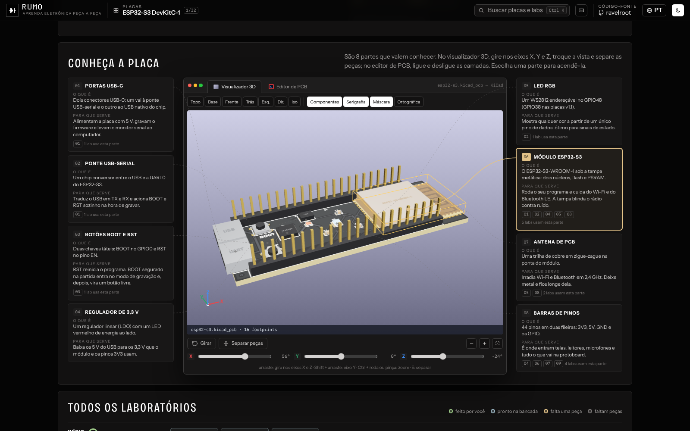
</p>

## O que o Rumo faz

- **32 placas e circuitos em cinco categorias:** microcontroladores (ESP32-S3, Arduino Uno, Raspberry Pi Pico, Arduino Nano, Arduino Mega, NodeMCU ESP8266, ESP32-CAM, STM32 Blue Pill, XIAO ESP32-C3 e micro:bit), computadores de placa única (Raspberry Pi 5 e Zero 2 W), hardware de PC (placa-mãe ATX, placa-mãe Mini-ITX, placa de vídeo, SSD NVMe, memória DDR5 e o interior de uma fonte ATX), módulos (ponte H L298N, relé, HC-SR04, RC522, A4988, LM2596, TP4056, MPU-6050, OLED SSD1306 e GPS NEO-6M) e circuitos (pisca com 555, fonte com 7805, amplificador LM386 e fonte linear com ponte de diodos).
- **Visualizador 3D no estilo KiCad:** cada placa é renderizada em WebGL com materiais físicos: FR-4 na borda, máscara de solda com o cobre aparecendo por baixo, pads em ouro (ENIG) ou estanho (HASL), serigrafia com as referências, furos, vias e componentes modelados (QFN, QFP, SOIC, DIP, BGA, blindagens, conectores, barras de pinos, eletrolíticos, cristais, dissipadores, slots, soquete LGA e outros), com luz de estúdio, reflexos e sombras. Há as vistas Topo, Base, Frente, Trás, Esquerda, Direita e Isométrica, camadas de Componentes, Serigrafia e Máscara, projeção ortográfica e o indicador de eixos. Arrastar gira nos eixos X e Z, `Shift` + arrastar gira no Y, e três controles deslizantes ajustam X, Y e Z em graus. Há giro automático, zoom (botões, `Ctrl` + roda ou pinça no celular), botão para centralizar e a vista explodida, que levanta as peças da placa com animação. Passar o mouse mostra a referência, o valor e a biblioteca do footprint.
- **Editor de PCB no estilo KiCad:** a mesma placa em 2D técnico, com as cores do Pcbnew: F.Cu, B.Cu, F.Silkscreen, F.Courtyard, F.Fab e Edge.Cuts, zonas de cobre com isolamento, trilhas a 0°, 45° e 90°, vias, pads SMD e THT, furos de fixação e grade ajustável de 0,635 a 50,8 mm. O painel de aparência liga e desliga camadas e objetos (pads, vias, zonas, referências, valores, números dos pads e grade), o painel de propriedades mostra referência, valor, footprint, camada, posição, corpo, pads e montagem, e a barra de status acompanha o cursor em milímetros. Arrastar move a vista e `Ctrl` + roda ou pinça dá zoom.
- **Peça a peça:** ao lado da placa, um cartão por parte diz **o que é** e **para que serve**, com linhas que ligam o cartão à peça na placa. Escolher um cartão ou clicar na peça, no 3D ou no editor de PCB, acende as duas e apaga o resto. Os cartões mostram também quais labs usam aquela parte.
- **Ficha técnica:** processador, memória, conexões, alimentação, tamanho e usos comuns de cada placa.
- **O que tem na sua bancada?** Marque as peças que você tem e o Rumo mostra quantos labs dá para montar agora, quais estão a uma peça de distância (e qual peça falta) e quantos pedem mais. "Tenho todas" e "Limpar" resolvem com um clique, e a busca filtra as peças.
- **Mapa de laboratórios:** os labs da placa agrupados por tema, com o estado de cada um (feito por você, pronto na bancada, falta uma peça, faltam peças) e a barra de progresso no topo.
- **Lab completo em seis abas:** Como (a teoria em blocos curtos), Fiação (diagrama animado fio a fio com anterior, tocar, próximo e mostrar todos, mais a tabela de pinos), Comandos (prontos para copiar), Passos (checklist salvo no navegador que marca o lab como feito), Prévia (o simulador) e Código (com botão de copiar). A barra de abas acompanha a rolagem e o rodapé leva ao próximo lab ou ao próximo tema.
- **16 simuladores:** monitor serial com comandos e LED (cores, pisca, respiração e SOS), varredura de Wi-Fi com canais e sinal, radar Bluetooth, sintetizador com teclado, formas de onda e som de verdade pelo Web Audio, escopo de dois microfones com bias e comparador, leitor RFID com memória do cartão e créditos, tela ST7789 e LCD 16×2, PWM, servo, ultrassom, mapa dos 40 pinos do Raspberry Pi, slots de memória em dual channel, LEDs de POST com cenários de falha, temporizador 555, regulador 7805 com calor e ponte H.
- **Busca e atalhos:** `Ctrl` + `K` ou `/` busca placas, partes e labs nas duas línguas. `,` e `.` trocam de placa, `[` e `]` trocam de lab, `P` abre o catálogo e `?` mostra todos os atalhos. Com a vista 3D em foco, as setas giram a placa e `E` separa as peças.
- **Idiomas e temas:** português e inglês em todo o conteúdo e tema claro e escuro. A escolha, as peças da bancada e os passos marcados ficam salvos no navegador.
- **Projeto de PCB gerado para cada placa:** 410 footprints com referências e bibliotecas no padrão do KiCad, mais de 12 mil pads, 1.020 trilhas e 677 vias, gerados de forma determinística a partir do desenho de cada placa.
- **Endereço por placa e por lab:** por exemplo, `#/atx` ou `#/esp32-s3/rfid-rc522`, bons para compartilhar ou usar em aula.

<p align="center">
  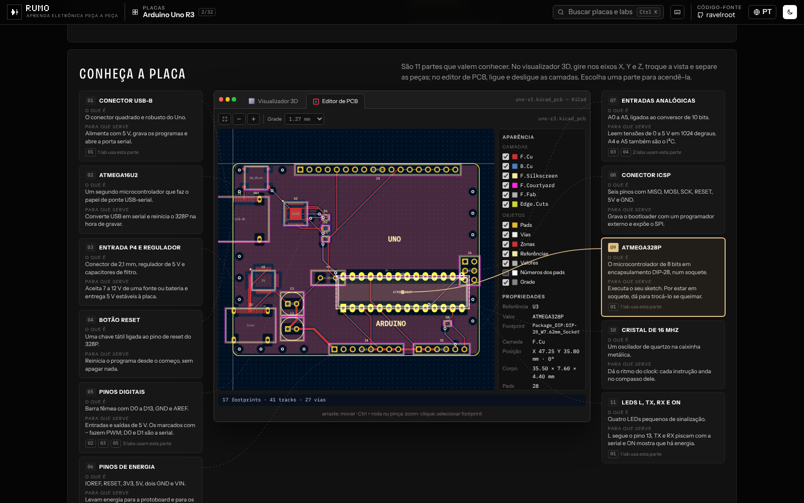
</p>

<p align="center">
  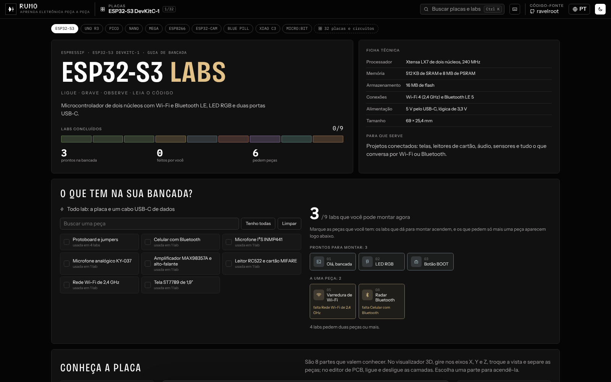
  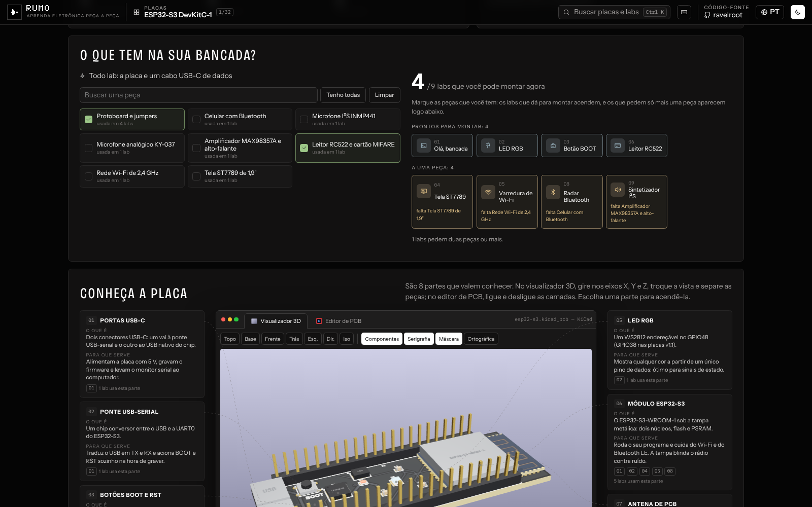
</p>

<p align="center">
  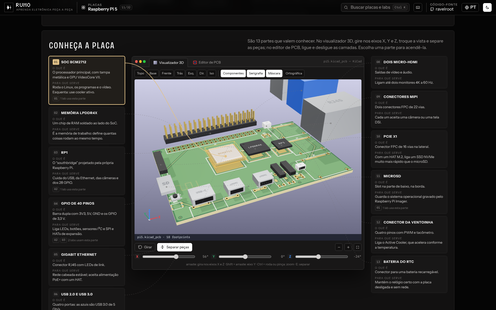
  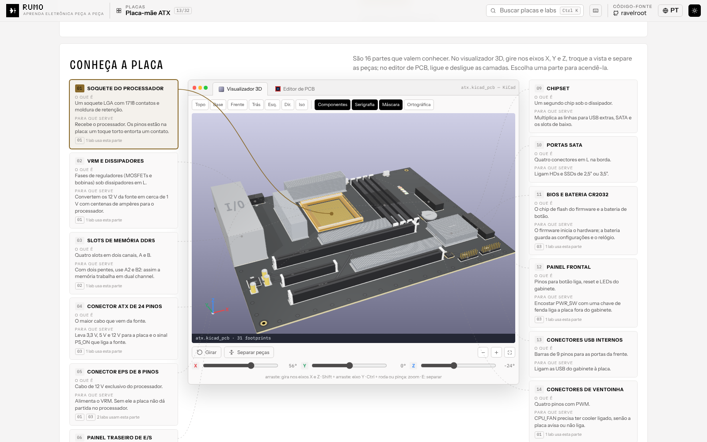
</p>

<p align="center">
  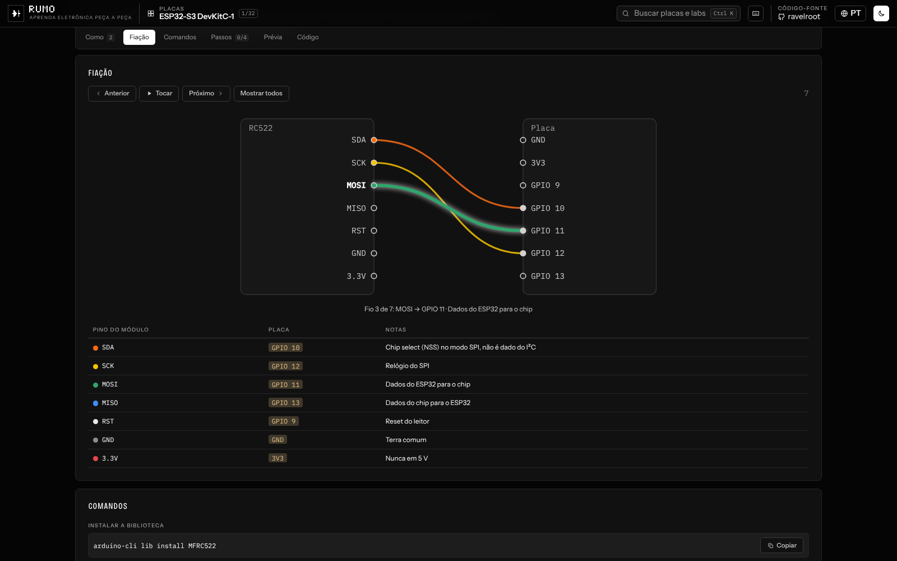
  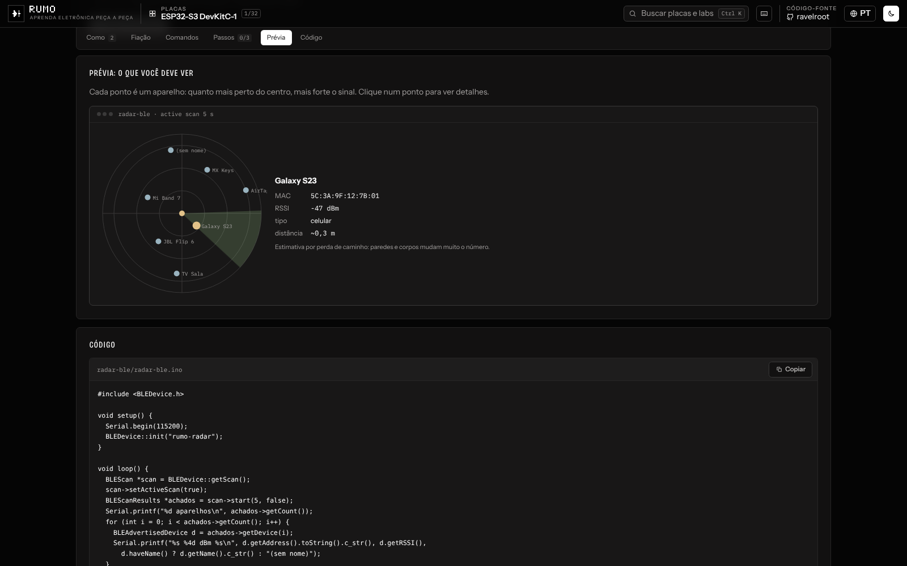
</p>

<p align="center">
  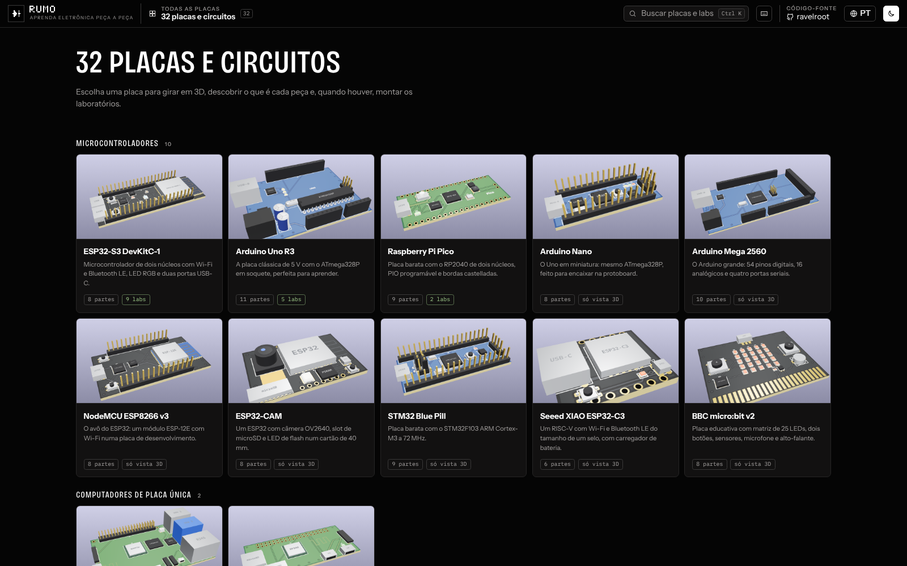
  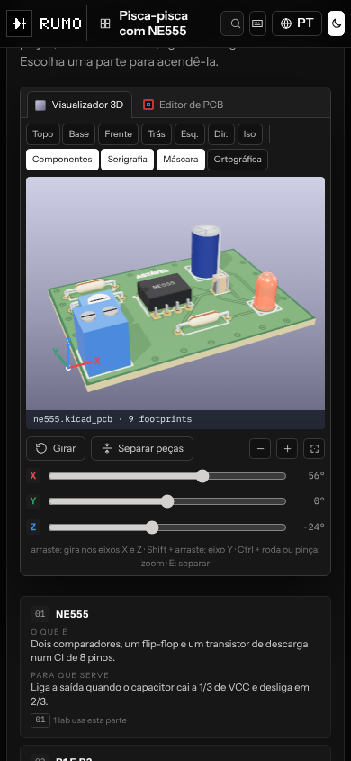
</p>

## Arquitetura

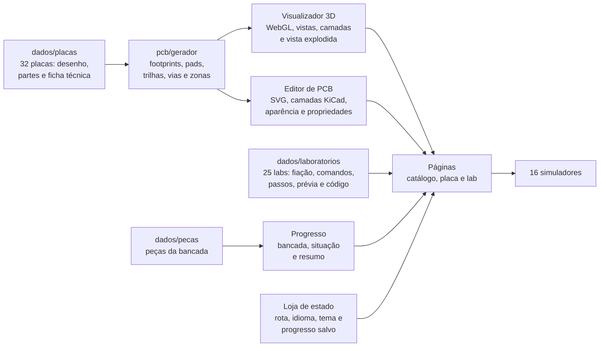

| Parte | Responsabilidade |
|---|---|
| `src/dados/tipos.ts` | Contrato de uma placa (desenho, partes, ficha e temas), de um lab e das prévias |
| `src/dados/placas` | As 32 placas, em cinco arquivos por categoria, e o catálogo ordenado |
| `src/dados/laboratorios` | Os 25 labs e as consultas por placa |
| `src/dados/pecas.ts` | As peças da bancada |
| `src/app` | Estado com leitura validada do navegador, rotas e cálculo da bancada |
| `src/pcb` | O modelo de um projeto de PCB (footprints, pads, trilhas, vias, furos e textos) e o gerador determinístico que classifica cada componente e monta o projeto |
| `src/ui/kicad/janela.ts` | A janela com as abas Visualizador 3D e Editor de PCB |
| `src/ui/kicad/visor3d.ts`, `cena.ts`, `modelos3d.ts`, `texturas.ts` | O visualizador 3D em WebGL: cena, luzes e ambiente, modelos dos componentes, texturas da face (máscara, cobre, serigrafia e acabamento), vistas, explosão, seleção e posição de cada parte na tela |
| `src/ui/kicad/editor2d.ts` | O editor de PCB em SVG: camadas, zonas, grade, cursor, painel de aparência e de propriedades |
| `src/ui/kicad/miniaturas.ts` | As miniaturas 3D do catálogo, renderizadas sob demanda e guardadas em memória |
| `src/ui/pagina-placa.ts`, `pagina-lab.ts`, `catalogo.ts` | As três páginas |
| `src/ui/fiacao.ts` | Diagrama de fiação animado e tabela de pinos |
| `src/ui/simuladores` | Os 16 simuladores |
| `src/i18n/textos.ts` | Textos da interface em português e inglês |
| `src/css/estilo.css` | Tokens da paleta do Bento nos dois temas, layout, janela no estilo KiCad, páginas, simuladores e responsivo |
| `tests/unit` | Catálogo, partes desenhadas, projetos de PCB, labs, bancada, progresso salvo e rotas |
| `tests/e2e` | Interface de ponta a ponta com Playwright |

### Como uma placa vira um projeto de PCB

Cada componente descreve só a posição, o tamanho em milímetros, a altura e a forma. O gerador classifica cada um num dos 38 modelos de footprint (QFN, QFP, SOIC, SOT, DIP, BGA, blindagem, conector, barra de pinos, slot, eletrolítico, MLCC, cristal, dissipador, soquete LGA e outros), dá a referência no padrão do KiCad (U, J, C, R, D, Y, SW, L, BT, HS), escolhe a biblioteca, gera os pads com o passo e o formato certos (incluindo matrizes BGA e LGA, bordas castelladas e contatos dourados de borda), detecta furos de fixação, liga pads vizinhos com trilhas octilineares em F.Cu e B.Cu com vias, costura as bordas com vias e preenche o plano de terra com isolamento. Tudo é determinístico: a mesma placa gera sempre o mesmo projeto.

O visualizador 3D desenha a face da placa num canvas (máscara, cobre sob a máscara, trilhas, pads com acabamento, vias, furos e serigrafia) e usa outro canvas como mapa de metal e rugosidade, para que só o cobre exposto reflita. Os componentes são modelos em three.js com materiais físicos, iluminados por um ambiente de estúdio, sombras suaves e tone mapping ACES, renderizados só quando algo muda. O editor de PCB desenha o mesmo projeto em SVG, uma camada por grupo, com as cores do Pcbnew.

## Como rodar

### No navegador

O Rumo está publicado em **https://ravelroot.github.io/Circuit-Board-Bench-Lab/**. Não precisa instalar nada.

### Desenvolvimento (somente o mantenedor)

O código está aberto para leitura, mas copiar, modificar ou redistribuir depende de autorização por escrito (veja a [Licença](#licença)). Para quem mantém o projeto, o fluxo é:

```bash
npm ci
npm run dev                       # http://localhost:5173
npm run build                     # gera a pasta dist/
npm run preview                   # http://localhost:4173
```

### Publicando no GitHub Pages

1. No repositório, abra **Settings** → **Pages**.
2. Em **Build and deployment**, escolha **GitHub Actions** como fonte.
3. Envie qualquer commit para a branch `main`. O workflow **GitHub Pages** roda os testes, gera o build e publica.
4. O endereço aparece na própria página de **Pages** e no resumo do workflow.

## Testes e qualidade

```bash
npm run typecheck                 # TypeScript em modo estrito
npm test                          # 329 testes unitários com Vitest
npx playwright install chromium
npm run test:e2e                  # interface de ponta a ponta com Playwright
```

Os testes unitários conferem o catálogo (pelo menos 30 placas, ids únicos e as cinco categorias), validam cada placa (textos nas duas línguas, toda parte com "o que é" e "para que serve", toda parte desenhada no 3D e todo componente dentro da placa), cada projeto de PCB (referências únicas no padrão do KiCad, bibliotecas, toda parte com footprint, pads, trilhas, vias e furos dentro da placa e trilhas só a 0°, 45° ou 90°), cada lab (placa, tema, partes e peças existentes, fiação, passos e código sem comentários), a bancada, o progresso salvo e as rotas. Os testes de interface giram a placa nos três eixos no visualizador 3D, separam as peças, acendem uma parte no 3D e no editor de PCB, ligam e desligam camadas, percorrem o catálogo, marcam peças e passos, usam o monitor serial, andam pela fiação e testam busca, idioma e tema. O CI roda a auditoria de dependências, o TypeScript, os testes, o build e o Playwright a cada push.

### Segurança

- **Política de segurança de conteúdo** no build: só scripts, estilos e fontes do próprio site, sem `eval`, sem estilos embutidos no HTML, sem objetos e sem formulários.
- **Nada de HTML montado a partir de texto:** a interface cria cada elemento pelo DOM, então nenhum conteúdo vira código.
- **Leitura validada do navegador:** peças, labs e passos salvos são conferidos contra o catálogo, com limite de tamanho, e qualquer valor desconhecido é descartado.
- **Rotas higienizadas:** o endereço só aceita letras, números e hífen e cai no catálogo se a placa não existir.
- **Sem servidor, sem cookies e sem rastreadores.** O áudio do sintetizador é gerado no próprio navegador e só começa com um toque.
- **Dependências mínimas:** em produção são só as fontes e o three.js, com versão fixa. O Dependabot acompanha npm e GitHub Actions toda semana.

## Atalhos de teclado

| Tecla | Ação |
|---|---|
| `Ctrl` + `K` ou `/` | Buscar placas, partes e labs |
| `P` | Catálogo de placas |
| `,` / `.` | Placa anterior / próxima |
| `[` / `]` | Lab anterior / próximo |
| `←` `→` `↑` `↓` | Girar a placa (com a vista 3D em foco) |
| `PgUp` / `PgDn` | Girar no eixo Y (com a vista 3D em foco) |
| `+` / `−` / `0` | Zoom e centralizar (com a vista 3D em foco) |
| `E` | Separar as peças |
| `←` `→` `↑` `↓` / `+` / `−` / `Home` | Mover, aproximar, afastar e ajustar a placa (com o editor de PCB em foco) |
| `G` | Giro automático (com a vista 3D em foco) |
| `T` | Tema claro ou escuro |
| `L` | Português ou inglês |
| `Esc` | Fechar a janela aberta |
| `?` | Folha de atalhos |

## As 32 placas e circuitos

| Placa | Resumo | Categoria | Partes | Labs |
|---|---|---|---|---|
| [ESP32-S3 DevKitC-1](https://ravelroot.github.io/Circuit-Board-Bench-Lab/#/esp32-s3) | Microcontrolador de dois núcleos com Wi-Fi e Bluetooth LE, LED RGB e duas portas USB-C. | Microcontrolador | 8 | 9 |
| [Arduino Uno R3](https://ravelroot.github.io/Circuit-Board-Bench-Lab/#/uno-r3) | A placa clássica de 5 V com o ATmega328P em soquete, perfeita para aprender. | Microcontrolador | 11 | 5 |
| [Raspberry Pi Pico](https://ravelroot.github.io/Circuit-Board-Bench-Lab/#/pico) | Placa barata com o RP2040 de dois núcleos, PIO programável e bordas castelladas. | Microcontrolador | 9 | 2 |
| [Arduino Nano](https://ravelroot.github.io/Circuit-Board-Bench-Lab/#/nano) | O Uno em miniatura: mesmo ATmega328P, feito para encaixar na protoboard. | Microcontrolador | 8 | — |
| [Arduino Mega 2560](https://ravelroot.github.io/Circuit-Board-Bench-Lab/#/mega2560) | O Arduino grande: 54 pinos digitais, 16 analógicos e quatro portas seriais. | Microcontrolador | 10 | — |
| [NodeMCU ESP8266 v3](https://ravelroot.github.io/Circuit-Board-Bench-Lab/#/nodemcu) | O avô do ESP32: um módulo ESP-12E com Wi-Fi numa placa de desenvolvimento. | Microcontrolador | 8 | — |
| [ESP32-CAM](https://ravelroot.github.io/Circuit-Board-Bench-Lab/#/esp32-cam) | Um ESP32 com câmera OV2640, slot de microSD e LED de flash num cartão de 40 mm. | Microcontrolador | 8 | — |
| [STM32 Blue Pill](https://ravelroot.github.io/Circuit-Board-Bench-Lab/#/bluepill) | Placa barata com o STM32F103 ARM Cortex-M3 a 72 MHz. | Microcontrolador | 9 | — |
| [Seeed XIAO ESP32-C3](https://ravelroot.github.io/Circuit-Board-Bench-Lab/#/xiao-c3) | Um RISC-V com Wi-Fi e Bluetooth LE do tamanho de um selo, com carregador de bateria. | Microcontrolador | 6 | — |
| [BBC micro:bit v2](https://ravelroot.github.io/Circuit-Board-Bench-Lab/#/microbit) | Placa educativa com matriz de 25 LEDs, dois botões, sensores, microfone e alto-falante. | Microcontrolador | 8 | — |
| [Raspberry Pi 5](https://ravelroot.github.io/Circuit-Board-Bench-Lab/#/pi5) | Um computador Linux completo do tamanho de um cartão de crédito, com PCIe e dois monitores 4K. | Computador de placa única | 13 | 3 |
| [Raspberry Pi Zero 2 W](https://ravelroot.github.io/Circuit-Board-Bench-Lab/#/pi-zero-2w) | Um Linux de quatro núcleos com Wi-Fi em 65 × 30 mm. | Computador de placa única | 9 | — |
| [Placa-mãe ATX](https://ravelroot.github.io/Circuit-Board-Bench-Lab/#/atx) | A placa principal de um PC de mesa: liga processador, memória, vídeo, discos e tudo mais. | Hardware de PC | 16 | 3 |
| [Placa-mãe Mini-ITX](https://ravelroot.github.io/Circuit-Board-Bench-Lab/#/mini-itx) | Uma placa-mãe de 17 × 17 cm com tudo o essencial: um slot PCIe, dois de memória e Wi-Fi. | Hardware de PC | 11 | — |
| [Placa de vídeo (PCB)](https://ravelroot.github.io/Circuit-Board-Bench-Lab/#/gpu) | A placa de circuito de uma placa de vídeo, como fica quando se tira o cooler. | Hardware de PC | 8 | — |
| [SSD M.2 NVMe 2280](https://ravelroot.github.io/Circuit-Board-Bench-Lab/#/ssd-nvme) | Um disco de estado sólido do tamanho de um chiclete, ligado direto à PCIe. | Hardware de PC | 6 | — |
| [Memória DDR5 UDIMM](https://ravelroot.github.io/Circuit-Board-Bench-Lab/#/ddr5) | Um pente de memória de desktop com gerenciamento de energia no próprio módulo. | Hardware de PC | 5 | — |
| [Fonte ATX (vista interna)](https://ravelroot.github.io/Circuit-Board-Bench-Lab/#/fonte-atx) | O interior de uma fonte chaveada de PC, do plugue da tomada aos cabos de 12 V. | Hardware de PC | 10 | — |
| [Ponte H L298N](https://ravelroot.github.io/Circuit-Board-Bench-Lab/#/l298n) | Módulo com ponte H dupla que controla dois motores DC ou um motor de passo. | Módulo | 8 | 1 |
| [Módulo relé 1 canal 5 V](https://ravelroot.github.io/Circuit-Board-Bench-Lab/#/rele) | Uma chave eletromecânica comandada por um pino de 3,3 ou 5 V. | Módulo | 7 | — |
| [Sensor ultrassônico HC-SR04](https://ravelroot.github.io/Circuit-Board-Bench-Lab/#/hcsr04) | Mede distância pelo eco de um pulso de 40 kHz, de 2 cm a 4 m. | Módulo | 4 | — |
| [Leitor RFID RC522](https://ravelroot.github.io/Circuit-Board-Bench-Lab/#/rc522) | Leitor e gravador de cartões MIFARE de 13,56 MHz por SPI. | Módulo | 6 | — |
| [Driver de passo A4988](https://ravelroot.github.io/Circuit-Board-Bench-Lab/#/a4988) | Driver de motor de passo bipolar com microstepping até 1/16. | Módulo | 5 | — |
| [Regulador buck LM2596](https://ravelroot.github.io/Circuit-Board-Bench-Lab/#/lm2596) | Conversor DC-DC abaixador ajustável que esquenta muito menos que um regulador linear. | Módulo | 7 | — |
| [Carregador de lítio TP4056](https://ravelroot.github.io/Circuit-Board-Bench-Lab/#/tp4056) | Carregador de uma célula de lítio de 1 A com proteção de bateria. | Módulo | 7 | — |
| [Acelerômetro e giroscópio MPU-6050](https://ravelroot.github.io/Circuit-Board-Bench-Lab/#/mpu6050) | Sensor de movimento com acelerômetro e giroscópio de 3 eixos por I²C. | Módulo | 5 | — |
| [Tela OLED 0,96" SSD1306](https://ravelroot.github.io/Circuit-Board-Bench-Lab/#/oled-ssd1306) | Tela OLED de 128 × 64 pixels, sem luz de fundo, por I²C. | Módulo | 5 | — |
| [GPS u-blox NEO-6M](https://ravelroot.github.io/Circuit-Board-Bench-Lab/#/neo6m) | Receptor GPS que entrega posição, hora e velocidade em frases NMEA pela serial. | Módulo | 7 | — |
| [Pisca-pisca com NE555](https://ravelroot.github.io/Circuit-Board-Bench-Lab/#/ne555) | O 555 em modo astável: dois resistores e um capacitor definem o ritmo de um LED. | Circuito | 6 | 1 |
| [Fonte regulada com LM7805](https://ravelroot.github.io/Circuit-Board-Bench-Lab/#/lm7805) | Regulador linear clássico: entra de 7 a 20 V, sai 5 V firmes. | Circuito | 6 | 1 |
| [Amplificador de áudio LM386](https://ravelroot.github.io/Circuit-Board-Bench-Lab/#/lm386) | Um amplificador de meio watt que faz um alto-falante tocar a partir de um sinal fraco. | Circuito | 8 | — |
| [Fonte linear com ponte de diodos](https://ravelroot.github.io/Circuit-Board-Bench-Lab/#/retificador) | Transformador, ponte de diodos e filtro: o caminho clássico da tomada até a tensão contínua. | Circuito | 8 | — |

## Os 25 laboratórios

| Lab | Placa | Tema | Fiação | Prévia | Código |
|---|---|---|---|---|---|
| [Olá, bancada](https://ravelroot.github.io/Circuit-Board-Bench-Lab/#/esp32-s3/ola) | ESP32-S3 DevKitC-1 | Início | — | Monitor serial | sim |
| [LED RGB](https://ravelroot.github.io/Circuit-Board-Bench-Lab/#/esp32-s3/led-rgb) | ESP32-S3 DevKitC-1 | Início | — | Monitor serial | sim |
| [Botão BOOT](https://ravelroot.github.io/Circuit-Board-Bench-Lab/#/esp32-s3/botao-boot) | ESP32-S3 DevKitC-1 | Início | — | Monitor serial | sim |
| [Tela ST7789](https://ravelroot.github.io/Circuit-Board-Bench-Lab/#/esp32-s3/tela-st7789) | ESP32-S3 DevKitC-1 | Tela e entrada | sim | Tela | sim |
| [Varredura de Wi-Fi](https://ravelroot.github.io/Circuit-Board-Bench-Lab/#/esp32-s3/wifi-scan) | ESP32-S3 DevKitC-1 | Wi-Fi | — | Varredura de Wi-Fi | sim |
| [Leitor RC522](https://ravelroot.github.io/Circuit-Board-Bench-Lab/#/esp32-s3/rfid-rc522) | ESP32-S3 DevKitC-1 | RFID e NFC | sim | Leitor RFID | sim |
| [Dois microfones](https://ravelroot.github.io/Circuit-Board-Bench-Lab/#/esp32-s3/microfones) | ESP32-S3 DevKitC-1 | Sensores | sim | Escopo de microfones | sim |
| [Radar Bluetooth](https://ravelroot.github.io/Circuit-Board-Bench-Lab/#/esp32-s3/radar-ble) | ESP32-S3 DevKitC-1 | Bluetooth LE | — | Radar BLE | sim |
| [Sintetizador I²S](https://ravelroot.github.io/Circuit-Board-Bench-Lab/#/esp32-s3/sintetizador) | ESP32-S3 DevKitC-1 | Som | sim | Sintetizador | sim |
| [Pisca o L](https://ravelroot.github.io/Circuit-Board-Bench-Lab/#/uno-r3/uno-blink) | Arduino Uno R3 | Início | — | Monitor serial | sim |
| [Brilho com PWM](https://ravelroot.github.io/Circuit-Board-Bench-Lab/#/uno-r3/uno-fade) | Arduino Uno R3 | PWM e movimento | sim | PWM | sim |
| [Servo com potenciômetro](https://ravelroot.github.io/Circuit-Board-Bench-Lab/#/uno-r3/uno-servo) | Arduino Uno R3 | PWM e movimento | sim | Servo | sim |
| [LCD 16×2 por I²C](https://ravelroot.github.io/Circuit-Board-Bench-Lab/#/uno-r3/uno-lcd) | Arduino Uno R3 | Tela | sim | Tela | sim |
| [Distância por ultrassom](https://ravelroot.github.io/Circuit-Board-Bench-Lab/#/uno-r3/uno-ultrassom) | Arduino Uno R3 | Sensores | sim | Ultrassom | sim |
| [MicroPython e LED](https://ravelroot.github.io/Circuit-Board-Bench-Lab/#/pico/pico-blink) | Raspberry Pi Pico | Início | — | Monitor serial | sim |
| [Termômetro interno](https://ravelroot.github.io/Circuit-Board-Bench-Lab/#/pico/pico-temperatura) | Raspberry Pi Pico | Sensores | — | Monitor serial | sim |
| [Gravar o sistema](https://ravelroot.github.io/Circuit-Board-Bench-Lab/#/pi5/pi-sistema) | Raspberry Pi 5 | Sistema | — | Monitor serial | — |
| [LED e botão com gpiozero](https://ravelroot.github.io/Circuit-Board-Bench-Lab/#/pi5/pi-gpio) | Raspberry Pi 5 | GPIO | sim | Monitor serial | sim |
| [Mapa dos 40 pinos](https://ravelroot.github.io/Circuit-Board-Bench-Lab/#/pi5/pi-pinagem) | Raspberry Pi 5 | GPIO | — | Mapa de pinos | — |
| [Processador e cooler](https://ravelroot.github.io/Circuit-Board-Bench-Lab/#/atx/atx-cpu) | Placa-mãe ATX | Montagem | — | LEDs de POST | — |
| [Memória em dual channel](https://ravelroot.github.io/Circuit-Board-Bench-Lab/#/atx/atx-memoria) | Placa-mãe ATX | Montagem | — | Slots de memória | — |
| [Primeira partida na bancada](https://ravelroot.github.io/Circuit-Board-Bench-Lab/#/atx/atx-bancada) | Placa-mãe ATX | Primeira partida | — | LEDs de POST | — |
| [Ajustar o pisca](https://ravelroot.github.io/Circuit-Board-Bench-Lab/#/ne555/ne555-pisca) | Pisca-pisca com NE555 | Circuito | — | Temporizador 555 | — |
| [Quanto esquenta o 7805](https://ravelroot.github.io/Circuit-Board-Bench-Lab/#/lm7805/lm7805-fonte) | Fonte regulada com LM7805 | Circuito | — | Regulador linear | — |
| [Sentido e velocidade](https://ravelroot.github.io/Circuit-Board-Bench-Lab/#/l298n/l298n-motor) | Ponte H L298N | Circuito | sim | Ponte H | sim |

## Estrutura de pastas

```
src/
  app/                      estado, rotas e cálculo da bancada
  css/                      estilo.css com tokens, janela KiCad, páginas, simuladores e responsivo
  dados/
    placas/                 as 32 placas em cinco arquivos e o catálogo
    laboratorios/           os 25 labs
    pecas.ts                peças da bancada
    tipos.ts                contrato de dados
  i18n/                     textos da interface em português e inglês
  pcb/                      modelo e gerador dos projetos de PCB
  ui/
    kicad/                  visualizador 3D, editor de PCB, janela e miniaturas
    simuladores/            os 16 simuladores
  main.ts                   ponto de entrada, rotas e atalhos de teclado
public/                     ícone
tests/
  unit/                     Vitest
  e2e/                      Playwright
docs/                       manuais em PDF e imagens do README
.github/                    CI, GitHub Pages e Dependabot
VERSION                     versão do projeto
```

### Componentes de terceiros

O Rumo depende de componentes com licenças próprias, que continuam valendo para cada um deles:

| Componente | Uso no projeto | Licença |
|---|---|---|
| [three.js](https://threejs.org/) | Renderização 3D em WebGL | MIT |
| [Vite](https://vite.dev/) | Servidor de desenvolvimento e build | MIT |
| [TypeScript](https://www.typescriptlang.org/) | Linguagem e verificação de tipos | Apache-2.0 |
| [Vitest](https://vitest.dev/) | Testes unitários | MIT |
| [Playwright](https://playwright.dev/) | Testes de ponta a ponta | Apache-2.0 |
| [Bricolage Grotesque](https://fonts.google.com/specimen/Bricolage+Grotesque), [Instrument Sans](https://fonts.google.com/specimen/Instrument+Sans) e [IBM Plex Mono](https://www.ibm.com/plex/) via [Fontsource](https://fontsource.org/) | Tipografia | OFL-1.1 |

Os desenhos das placas e os projetos de PCB gerados são representações didáticas, com posições e medidas aproximadas, e não substituem o esquema ou a folha de dados do fabricante. Os nomes de produtos e marcas citados pertencem aos seus donos.

## Licença

Copyright (©) 2026 Erik Pimenta. Todos os direitos reservados.

O Rumo é distribuído sob uma [licença de uso](LICENSE): qualquer pessoa pode usar a ferramenta publicada, gratuitamente, para estudo, aula ou trabalho. Copiar, modificar, redistribuir, hospedar em outro endereço ou reutilizar o código, os textos, os dados das placas, os desenhos, o nome ou a logo depende de autorização por escrito do autor. Os componentes de terceiros listados acima continuam sob as próprias licenças.
